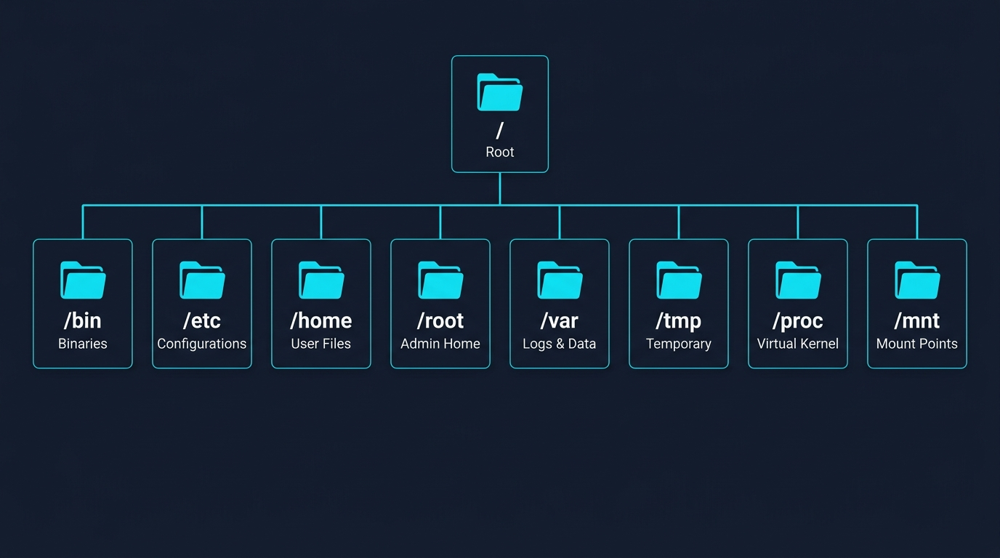
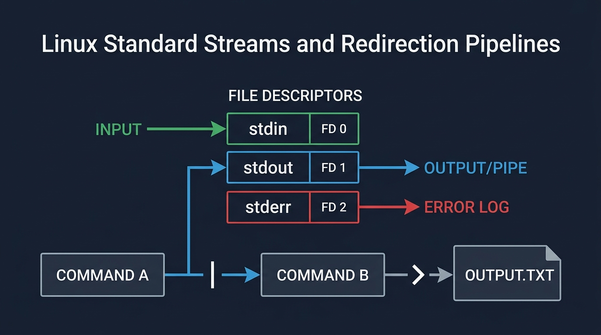
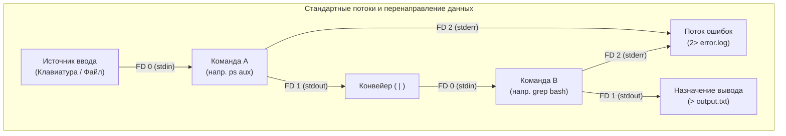

# Модуль 1: Основы, инструментарий и процессы — Методическое руководство для студентов

## 1. Настройка локального окружения и жизненный цикл ВМ

В корпоративной DevOps-инженерии разработчики и системные инженеры крайне редко запускают рабочие нагрузки напрямую в основной операционной системе своей рабочей станции. Стандартом индустрии является использование легковесной виртуализации (WSL 2 на Windows или Multipass на macOS) для локального запуска точных серверных ядер Linux. Это гарантирует, что скрипты, утилиты и контейнерные среды будут вести себя абсолютно идентично облачным staging- и production-кластерам.

### Windows (WSL 2)

Выполните следующие команды PowerShell с правами администратора для развертывания, управления и остановки локального инстанса Ubuntu Linux:

```powershell
# 1. Создание и установка инстанса (выполняется в PowerShell от имени Администратора):
wsl --install -d Ubuntu --name devops-vm
# (Перезагрузите ПК при появлении запроса, затем задайте начальное имя пользователя и пароль)

# 2. Просмотр списка и статуса всех инстансов:
wsl -l -v

# 3. Запуск и подключение (вход в интерактивную оболочку Linux):
wsl -d devops-vm

# 4. Отключение (выход из оболочки обратно в Windows PowerShell — выполняется внутри Linux):
exit   # или нажмите Ctrl+D

# 5. Остановка конкретного работающего инстанса (выполняется в PowerShell):
wsl --terminate devops-vm   # или: wsl -t devops-vm

# 6. Полная остановка всех инстансов WSL (выключение гипервизора):
wsl --shutdown
```

- **Ввод пароля:** Символы пароля при вводе в терминале Linux не отображаются (защита от подглядывания из-за плеча).
- **Начальное обновление:** После первого входа в оболочку выполните команду `sudo apt update && sudo apt upgrade -y`.

### macOS (Multipass)

Выполните следующие команды в терминале macOS для инициализации, проверки параметров и удаления облачного инстанса Ubuntu с помощью Multipass:

```bash
# 1. Установка Multipass через Homebrew (выполняется в терминале macOS):
brew install --cask multipass

# 2. Создание и запуск виртуальной машины:
multipass launch --name devops-vm --cpus 2 --memory 2G --disk 10G

# 3. Просмотр списка и детальной информации о виртуальных машинах:
multipass list
multipass info devops-vm

# 4. Запуск инстанса (старт ВМ в фоновом режиме):
multipass start devops-vm

# 5. Подключение (открытие интерактивной оболочки внутри ВМ):
multipass shell devops-vm

# 6. Отключение (выход из оболочки в терминал macOS — ВМ продолжит работу в фоне):
exit   # или нажмите Ctrl+D

# 7. Остановка инстанса (штатное выключение):
multipass stop devops-vm

# 8. Полное удаление и очистка диска:
multipass delete devops-vm && multipass purge
```

- **Настройка пароля:** Инстансы Multipass по умолчанию создают пользователя `ubuntu` без пароля. Внутри `devops-vm` сразу выполните `sudo passwd ubuntu`, чтобы задать пароль (он потребуется для команд `sudo`).
- **Начальное обновление:** Выполните команду `sudo apt update && sudo apt upgrade -y`.

---

## 2. Базовая архитектура Linux

- **Ядро (Kernel):** Центральный компонент операционной системы, отвечающий за распределение процессорного времени, выделение страниц оперативной памяти, операции ввода-вывода накопителей и управление сетевыми интерфейсами.
- **Оболочка (Shell, `bash`):** Командный интерпретатор, преобразующий вводимые пользователем команды и скрипты в низкоуровневые системные вызовы ядра (syscalls).
- **Headless-сервер:** Серверные инстансы в облаке работают без графического интерфейса пользователя (GUI). Отказ от графической оболочки экономит гигабайты оперативной памяти, исключает сотни потенциальных уязвимостей и обеспечивает мгновенную загрузку серверов.
- **Принцип «Всё есть файл» (Everything is a file):** Физические устройства, состояния запущенных процессов, сетевые сокеты и системные параметры представлены в Linux в виде файлов в рамках единого дерева файловой системы.

---

## 3. Стандарт иерархии файловой системы (FHS)

В Linux действует единая иерархия каталогов с единым корнем `/` (root), без букв дисков в стиле Windows (`C:`, `D:`). В корпоративной инфраструктуре строгое следование стандарту FHS позволяет инструментам автоматизации (Ansible, Puppet, Terraform) надежно использовать предсказуемые пути во всех дистрибутивах Linux.



| Директория | Назначение | Типичное содержимое | Значение для Production |
| :--- | :--- | :--- | :--- |
| `/` | Корень файловой системы | Начало всей файловой иерархии | Точка монтирования корневого раздела. |
| `/bin`, `/usr/bin` | Пользовательские бинарные файлы | Стандартные команды (`ls`, `cp`, `bash`, `nano`) | Исполняемые файлы из системного PATH, необходимые для работы. |
| `/etc` | Системные конфигурации | Текстовые файлы настроек сервисов (`hosts`, `nginx.conf`) | Управляются через Infrastructure as Code; никогда не правятся вручную на продакшене. |
| `/home` | Рабочие каталоги пользователей | `/home/student/` (личные файлы пользователя) | Домашние директории непривилегированных пользователей. |
| `/root` | Домашний каталог суперпользователя | Личные файлы системного администратора root | Рабочая директория root; прямой вход по SSH обычно заблокирован. |
| `/var` | Переменные динамические данные | Системные логи (`/var/log/`), веб-сайты (`/var/www/`) | Часто выносится на отдельный дисковый раздел для защиты корня от переполнения логами. |
| `/tmp` | Временное пространство | Файлы, очищаемые при перезагрузке системы | Доступна для записи всем пользователям; энергозависимое рабочее пространство. |
| `/proc` | Состояния ядра во время работы | Виртуальные метрики в оперативной памяти (`/proc/cpuinfo`) | Виртуальная псевдо-файловая система, отражающая параметры ядра в реальном времени. |
| `/mnt` | Точки монтирования | Доступ к дискам хоста (например, `/mnt/c` в WSL 2) | Временное подключение внешних дисковых накопителей или общих папок хоста. |

### Синтаксис путей и специальные обозначения
- **Абсолютный путь:** Всегда начинается с корня `/`. Однозначно указывает точное расположение файла от корневого каталога (`/var/log/dpkg.log`). Работает одинаково вне зависимости от текущего каталога.
- **Относительный путь:** Не начинается со слэша `/`. Рассчитывается относительно текущего каталога (`../configs/app.conf`).
- `.` = Текущий рабочий каталог
- `..` = Родительский каталог (на один уровень выше)
- `~` = Домашний каталог текущего пользователя (`/home/<username>`)
- `-` = Предыдущий рабочий каталог (`cd -` переключает между текущим и предыдущим каталогами)

---

## 4. Управление файлами и каталогами

### Навигация и исследование
- `pwd` — Выводит полный путь к текущему рабочему каталогу. Используется в скриптах развертывания для проверки контекста перед запуском команд.
- `ls` — Выводит список видимых файлов в каталоге.
- `ls -l` — Подробный длинный список с правами доступа, количеством ссылок, владельцем, группой, размером в байтах и датой изменения.
- `ls -la` — Длинный список с отображением скрытых файлов, начинающихся с точки (`.`). Необходим для поиска файлов переменных окружения (`.env`), каталогов git (`.git`) и ключей доступа.
- `ls -lh` — Длинный список с размерами в удобном для человека виде (K, M, G). Применяется для быстрого выявления тяжелых логов и дампов баз данных.
- `ls -lt` — Сортировка файлов по времени изменения (сначала самые новые).
- `ls -lart` — Обратная сортировка по времени: отображает самые свежие измененные файлы в самом низу экрана терминала для удобства при разборе инцидентов.
- `ls -ld [dir]` — Просмотр атрибутов самого каталога без вывода его содержимого.
- `ls -R` — Рекурсивный вывод всех подкаталогов и файлов в дереве директорий.
- `cd [path]` — Переход в указанный каталог (`cd /etc`, `cd ~`, `cd ..`).

### Операции с файлами (`cp`, `mv`, `rm`, `touch`, `mkdir`)

Управление конфигурационными файлами, артефактами сборок и структурой директорий на удаленных серверах Linux требует строгой дисциплины при работе с файловыми операциями. В отличие от десктопных операционных систем, в командной строке Linux нет отмены действий (Ctrl+Z) и нет корзины для удаленных файлов.

#### Создание директорий и инициализация файлов
- `mkdir -p [dir/subdir]` создает вложенные структуры директорий идемпотентно, не завершаясь ошибкой, если промежуточные каталоги уже существуют. Стандарт при написании шагов в пайплайнах CI/CD.
- `touch [file]` создает пустой файл, если он не существует, либо обновляет временную метку последнего изменения существующего файла. Часто применяется для создания файлов-блокировок (lockfiles) или сигналов перезагрузки сервисов.

Создайте вложенное дерево каталогов для учебного окружения и инициализируйте пустой конфигурационный файл:
```bash
mkdir -p ~/devops_lab/configs/nginx
touch ~/devops_lab/configs/nginx/default.conf
```

#### Копирование файлов и директорий (`cp`)
Утилита `cp` создает дубликаты файлов и каталогов в файловой системе. При изменении системных настроек создание локальной резервной копии (`.bak` или `.orig`) перед редактированием является фундаментальной привычкой системного инженера.

Основные флаги утилиты:
- `cp [src] [dst]` — Копирует один файл. Если назначением является существующий каталог, файл копируется внутрь этого каталога с сохранением исходного имени.
- `cp -i [src] [dst]` — Интерактивный режим: запрашивает подтверждение перед перезаписью уже существующего целевого файла.
- `cp -r [src_dir] [dst_dir]` — Рекурсивное копирование: обязательно при копировании структуры каталогов. Пропуск ключа `-r` при копировании папки приводит к ошибке: `cp: -r not specified; omitting directory`.
- `cp -a [src_dir] [dst_dir]` — Архивное копирование: объединяет ключ `-r` с сохранением прав доступа, владельца/группы (UID/GID) и исходных временных меток (`--preserve=all`). Обязательный стандарт в DevOps при подготовке резервных копий конфигураций перед обновлением системы.

Создайте резервную копию конфигурационного файла, а затем скопируйте всю директорию в архивном режиме с сохранением метаданных:
```bash
cp ~/devops_lab/configs/nginx/default.conf ~/devops_lab/configs/nginx/default.conf.bak
cp -a ~/devops_lab/configs ~/devops_lab/configs_backup
```

#### Перемещение и переименование (`mv`)
В операционной системе Linux переименование файла и его перемещение в другой каталог являются одной и той же операцией на уровне файловой системы (изменение указателя в таблице директорий на соответствующий inode). Утилита `mv` выполняет обе задачи:

- **Переименование на месте:** Если целевой путь представляет собой имя файла в текущем каталоге, `mv` переименовывает файл без перемещения блоков данных на диске.
- **Перемещение в каталог:** Если целевой путь является существующей директорией, `mv` переносит файл внутрь этого каталога.
- **Ловушка перезаписи:** Если выполняется команда `mv file1.txt file2.txt`, и файл `file2.txt` уже существовал, он будет перезаписан без предупреждений. Для защиты от случайной перезаписи используйте `mv -i` (запрос подтверждения) или `mv -n` (запрет перезаписи).

Переименуйте резервную копию файла, а затем переместите переименованный файл в отдельный каталог для архивов:
```bash
mkdir -p ~/devops_lab/archive
mv ~/devops_lab/configs/nginx/default.conf.bak ~/devops_lab/configs/nginx/legacy.conf
mv ~/devops_lab/configs/nginx/legacy.conf ~/devops_lab/archive/
```

#### Безопасное безвозвратное удаление (`rm`)
> [!CAUTION]
> Команда `rm` выполняет **полное и безвозвратное удаление** на уровне файловой системы. В консоли Linux нет корзины. После отвязки inode и освобождения дисковых блоков восстановить файлы стандартными средствами невозможно.

Ключевые флаги удаления:
- `rm [file]` — Удаляет один регулярный файл.
- `rm -i [file]` — Запрашивает интерактивное подтверждение перед удалением каждого файла (защитный механизм при ручных работах).
- `rm -r [dir]` — Рекурсивно удаляет каталог со всеми вложенными подкаталогами и файлами.
- `rm -rf [dir]` — Принудительно (`-f`) и рекурсивно (`-r`) удаляет директорию без запросов подтверждения, игнорируя отсутствующие файлы. Стандартный шаг очистки рабочих областей в пайплайнах CI/CD, требующий предельной точности в путях.

**Критические опасности при удалении:**
1. **Случайный пробел:** Команда `rm -rf / tmp/cache` вместо `rm -rf /tmp/cache` попытается удалить всю корневую файловую систему (`/`). Современные дистрибутивы защищают корень через параметр `--preserve-root`, однако удаление критических веток вида `rm -rf /var /cache` остаётся фатальным.
2. **Ошибки с масками (wildcards):** Команда `rm -f *.log` удаляет логи в папке, но случайный пробел `rm -f * .log` приведет к удалению **абсолютно всех файлов** в текущем рабочем каталоге.

Удалите временные демонстрационные файлы в интерактивном режиме и выполните очистку тестовой резервной копии:
```bash
rm -i ~/devops_lab/archive/legacy.conf
rm -rf ~/devops_lab/configs_backup
```

### Запись текста и перенаправление потоков
- `echo "[text]"` — Вывод строки текста на экран терминала (`echo "Hello DevOps"`).
- `echo "[text]" > [file]` — Запись текста в файл с **перезаписью** существующего содержимого (`echo "PORT=8080" > app.conf`).
- `echo "[text]" >> [file]` — Добавление текста в конец файла без перезаписи существующих данных (`echo "DEBUG=false" >> app.conf`). Применяется для безопасного добавления параметров в файлы настроек или `/etc/hosts`.

---

## 5. Терминальный текстовый редактор Nano

В производственных облачных средах системные инженеры подключаются к серверам по SSH без графического интерфейса. Быстрые консольные редакторы, такие как `nano`, позволяют оперативно вносить аварийные исправления непосредственно на сервере.

Открытие существующего конфигурационного файла или создание нового файла в терминале:
```bash
nano /path/to/file.conf
```

### Основные горячие клавиши
- **Клавиши со стрелками:** Перемещение курсора по символам и строкам.
- `Ctrl+O`, затем `Enter`: Сохранить изменения (WriteOut).
- `Ctrl+X`: Выйти из редактора (нажмите `Y`, затем `Enter` для сохранения изменений при выходе).
- `Ctrl+W`: Поиск текстовой строки в файле ("Where Is"). Критично для быстрого перехода к строке с ошибкой в длинных конфигах.
- `Ctrl+K`: Вырезать текущую строку в буфер.
- `Ctrl+U`: Вставить вырезанную строку из буфера.

---

## 6. Просмотр текста и фильтрация потоков

### Чтение файлов
- `cat [file]` — Вывод всего содержимого файла на экран. Рекомендуется исключительно для небольших конфигурационных файлов и коротких записей.
- `less [file]` — Интерактивный постраничный просмотрщик. Подгружает страницы файла в память по мере прокрутки без считывания всего многогигабайтного лога в RAM, предотвращая сбои по Out-Of-Memory.
  - `g` = Переход в самое начало файла
  - `G` = Переход в самый конец файла
  - `/[term]` = Поиск вперед по тексту (`n` — переход к следующему совпадению)
  - `q` = Выход из режима просмотра
- `head -n [N] [file]` — Отображение первых $N$ строк файла. Используется для просмотра структуры логов, CSV-заголовков и строк shebang.
- `tail -n [N] [file]` — Отображение последних $N$ строк файла.
- `tail -f [file]` — Потоковый вывод новых строк файла в реальном времени по мере их появления. Необходим для отслеживания входящих запросов веб-сервера и ошибок приложений во время деплоя.

### Стандартные потоки и конвейеры (Pipes)
Каждый процесс Linux автоматически открывает три стандартных потока данных POSIX (файловых дескриптора):
- `0` (`stdin`) — Стандартный ввод (клавиатура или входящий поток данных).
- `1` (`stdout`) — Стандартный вывод (назначение по умолчанию для успешного результата работы команды).
- `2` (`stderr`) — Стандартный поток ошибок (назначение по умолчанию для диагностических сообщений и ошибок).





### Поиск и конвейерная обработка
- `grep "[pattern]" [file]` — Вывод строк, соответствующих заданному шаблону.
- `grep -i "[pattern]" [file]` — Поиск без учета регистра символов (найдет `error`, `ERROR`, `Error`).
- `grep -rn "[pattern]" [dir]` — Рекурсивный поиск по всем файлам каталога с указанием номеров строк. Помогает находить жестко закодированные пароли или устаревшие адреса эндпоинтов в кодовой базе.
- `grep -v "[pattern]" [file]` — Инвертированный поиск: отображает строки, НЕ содержащие шаблон. Регулярно используется для отсечения комментариев и пустых строк из конфигурационных файлов (`grep -v '^#'`).
- `[command] | grep "[pattern]"` — Перенаправление вывода команды через фильтр grep (например, `ps aux | grep nginx`).

---

## 7. Управление пакетами с помощью APT

В Ubuntu используется пакетный менеджер `apt` (Advanced Package Tool) для загрузки и установки криптографически подписанных пакетов из централизованных репозиториев. В автоматизации установка пакетов встраивается в cloud-init скрипты, сборки Docker-образов и пайплайны Infrastructure as Code. Каталог пакетов и их зависимости можно найти на официальном портале [Ubuntu Packages Search](https://packages.ubuntu.com/).

### Базовый рабочий процесс с пакетами

Обновление индексов репозитория, поиск доступных пакетов, проверка зависимостей и неинтерактивная установка ПО:
```bash
# 1. Обновление локального индекса каталога пакетов (не устанавливает и не обновляет сами пакеты)
sudo apt update

# 2. Поиск утилиты в репозитории по ключевому слову
apt search [keyword]

# 3. Просмотр метаданных, версии и зависимостей пакета
apt show [package_name]

# 4. Установка пакета без интерактивных подтверждений (-y автоматически отвечает 'yes')
sudo apt install -y [package_name]

# 5. Вывод списка установленных пакетов с фильтрацией через grep
apt list --installed | grep [keyword]

# 6. Обновление всех установленных в системе пакетов до актуальных версий
sudo apt upgrade -y
```

### Удаление пакетов и очистка диска

Удаление неиспользуемых программных пакетов, очистка остаточных конфигурационных файлов и освобождение места на накопителе:
```bash
# Стандартное удаление (удаляет бинарники и библиотеки, но сохраняет конфигурационные файлы)
sudo apt remove -y [package_name]

# Полная зачистка (удаляет бинарники И все конфигурационные файлы)
sudo apt purge -y [package_name]

# Удаление изолированных зависимостей, которые больше не требуются ни одному пакету
sudo apt autoremove -y

# Очистка локального кэша загруженных .deb архивов для экономии места
sudo apt clean
```

---

## 8. Процессы и мониторинг ресурсов

**Процесс** — это выполняющаяся в оперативной памяти программа, которой ядро Linux присваивает уникальный числовой идентификатор **PID (Process ID)**. Понимание механизмов управления процессами позволяет инженерам диагностировать всплески нагрузки на CPU, инспектировать потоки приложений и безопасно останавливать зависшие службы.

### Анализ процессов
- `ps aux` — Моментальный снимок всех процессов, запущенных в системе.
  - `a` = Процессы всех пользователей
  - `u` = Отображение пользователя-владельца, процента CPU и процента памяти
  - `x` = Включение фоновых демонов, не привязанных к управляющему терминалу
- `top` — Интерактивный консольный монитор системных ресурсов в реальном времени.
  - `Shift+P` = Сортировка по потреблению CPU
  - `Shift+M` = Сортировка по потреблению оперативной памяти
  - `q` = Выход
- `htop` — Удобный визуальный монитор процессов.
  - `F5` = Режим дерева процессов (наглядно показывает иерархию процессов под PID 1)
  - `F6` = Выбор метрики для сортировки
  - `q` = Выход

---

## 9. Практика и дальнейшие шаги
- Используйте файл [linux_commands_cheat_sheet.md](./linux_commands_cheat_sheet.md) для быстрого поиска команд и флагов.
