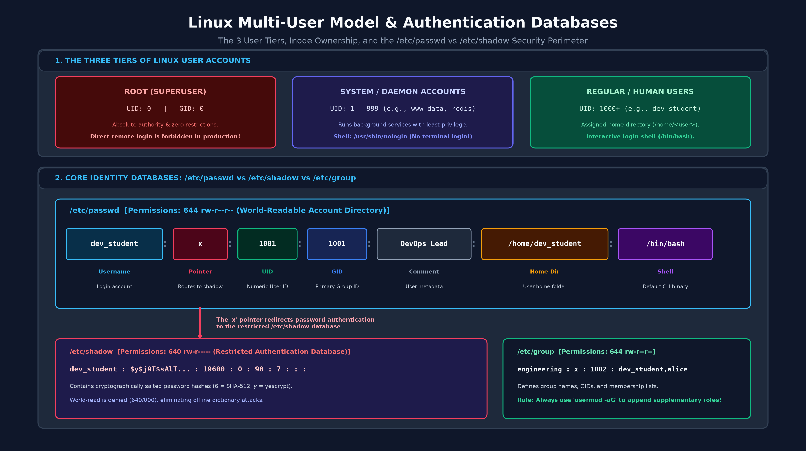
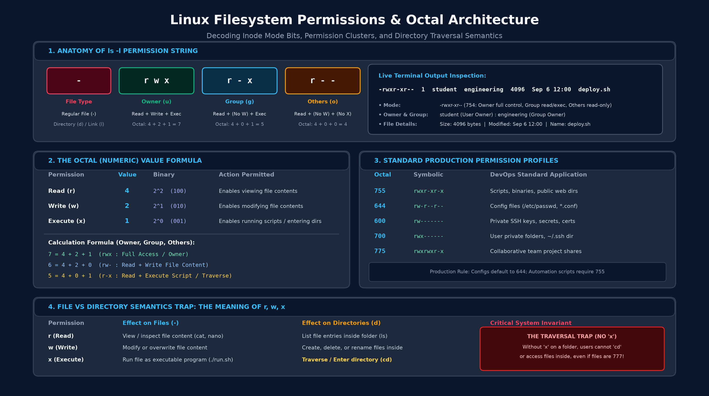
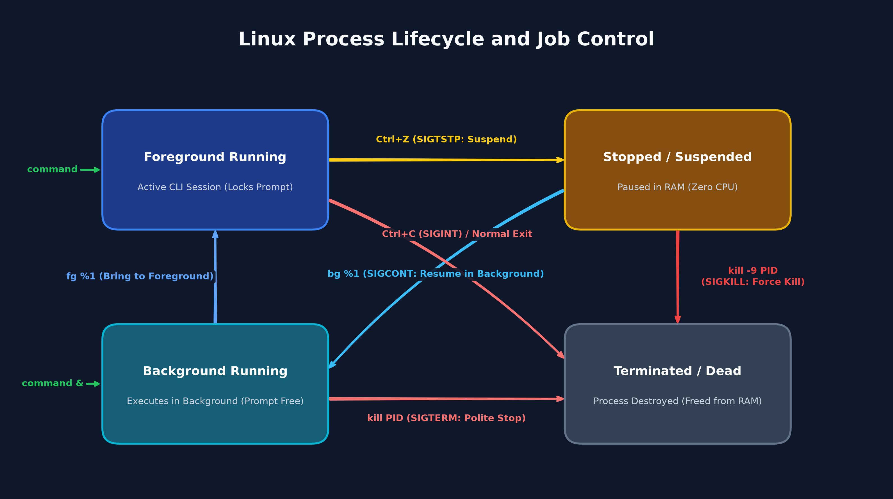
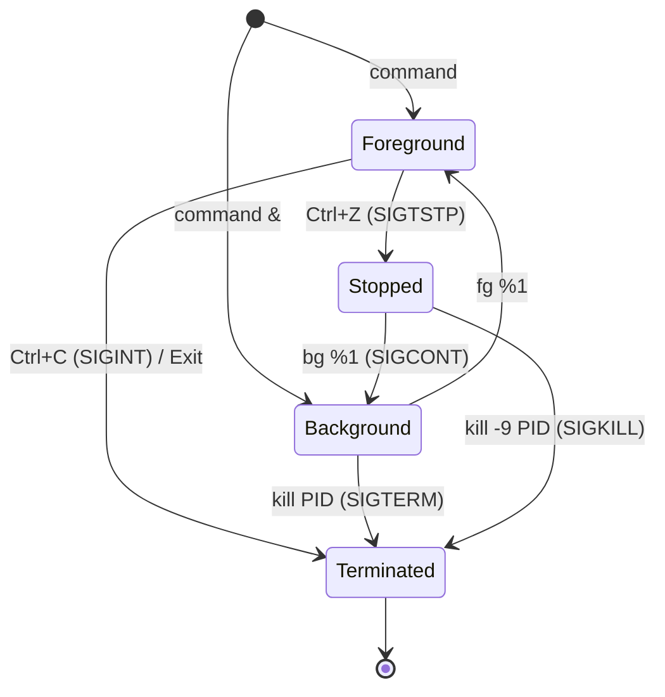

# Модуль 2: Безопасность и управление доступом — Конспект студента

## 1. Многопользовательская архитектура Linux

Linux с момента своего создания разрабатывался как многопользовательская операционная система. Ядро идентифицирует всех субъектов через числовые идентификаторы, а не через человекочитаемые имена пользователей:

- **UID (User ID):** Числовой идентификатор, присваиваемый каждой учетной записи. Ядро Linux оперирует исключительно числовыми UID, сопоставляя их с текстовыми именами пользователей только на уровне пользовательских утилит.
  - **UID 0:** Суперпользователь `root`. Полное отсутствие ограничений со стороны ядра; абсолютный контроль над всеми процессами, памятью и физическими устройствами (обход механизма DAC).
  - **UID 1 – 999:** Системные и сервисные учетные записи (например, `www-data`, `systemd-resolve`, `nginx`). Эти учетные записи запускают фоновые демоны по принципу наименьших привилегий (Principle of Least Privilege) и сконфигурированы с неинтерактивной командной оболочкой (`/usr/sbin/nologin`).
  - **UID 1000+:** Обычные пользователи-люди и интерактивные сервисные аккаунты. Им выделяется персональный домашний каталог в `/home/<user>` и интерактивная командная оболочка (`/bin/bash`).
- **GID (Group ID):** Числовой идентификатор системной группы пользователей:
  - **Основная группа (Primary GID):** Задается в четвертом поле `/etc/passwd`. Все новые файлы и каталоги, создаваемые пользователем, по умолчанию получают этот GID в качестве группы-владельца.
  - **Дополнительные группы (Supplementary GIDs):** Перечисляются в файле `/etc/group` (например, `sudo`, `docker`, `engineering`). Предоставляют инженеру права доступа к общим проектам, служебным сокетам и административным привилегиям.

> [!NOTE]
> В облачной инфраструктуре и контейнерных средах (Docker, Kubernetes) приложения никогда не должны выполняться от UID 0. Контейнерные образы настраиваются на запуск от выделенных непривилегированных UID (например, UID 10001), чтобы исключить компрометацию ядра хоста при атаках с выходом из контейнера (container breakout).

---

## 2. Базовые конфигурационные базы данных учетных записей

Сведения об учетных записях и параметры аутентификации хранятся в трех текстовых файлах конфигурации в каталоге `/etc/`. Разделение базы на общедоступный каталог (`passwd`) и закрытое хранилище секретов (`shadow`) защищает систему: непривилегированные утилиты (например, `ls -l`) могут сопоставлять числовые UID с именами пользователей, не получая доступа к хэшам паролей для офлайн-подбора (брутфорса).

### `/etc/passwd` (Каталог учетных записей — Права `644`)
Общедоступный для чтения список учетных записей пользователей в системе.
Формат: `username:password_marker:UID:GID:comment:home_directory:shell`
- *Пример:* `dev_student:x:1001:1001::/home/dev_student:/bin/bash`
- Символ `x` во втором поле указывает, что криптографический хэш пароля безопасно хранится в `/etc/shadow`.

### `/etc/shadow` (Секреты аутентификации — Права `640` или `000`)
Защищенный файл, доступный для чтения только суперпользователю `root` и группе `shadow`.
Формат: `username:$algorithm$salt$hash:last_changed:min_days:max_days:warn_days:inactive_days:expire_date:reserved`
- Структура поля пароля `$algorithm$salt$hash`:
  - **`$algorithm` (ID алгоритма):** Метод хэширования (`$6$` = SHA-512, `$y$` = yescrypt в Ubuntu 22.04/24.04, `$1$` = устаревший MD5).
  - **`$salt` (Криптографическая соль):** Случайная уникальная строка, добавляемая к паролю перед хэшированием для защиты от атак по радужным таблицам (rainbow tables). Гарантирует, что одинаковые пароли разных пользователей дают разные хэши.
  - **`$hash` (Результат хэширования):** Необратимый односторонний криптографический хэш. При входе ядро вычисляет хэш от введенного пароля с той же солью и сравнивает с сохраненным значением.

### `/etc/group` (Каталог групп — Права `644`)
Общедоступный для чтения список системных групп.
Формат: `group_name:password_marker:GID:member1,member2,...`
- *Пример:* `engineering:x:1002:dev_student,analyst_bob`



> [!TIP]
> В корпоративных средах локальные учетные записи синхронизируются с централизованными провайдерами идентификации через LDAP, Active Directory (через SSSD) или Okta PAM. Однако локальные административные аварийные аккаунты (break-glass) всегда настраиваются в `/etc/passwd` на случай сетевых сбоев.

---

## 3. Команды администрирования пользователей

Для создания пользователей в скриптах автоматизации и системах управления конфигурациями всегда используйте утилиту `useradd`:

- `id` — Отображение текущего UID, основного GID и дополнительных групп.
- `id [user]` — Отображение UID и групп конкретной учетной записи.
- `whoami` — Вывод имени текущего активного пользователя.
- `sudo useradd -m -s [shell] [username]` — Создание нового пользователя с домашней директорией (`-m`) и оболочкой по умолчанию (`-s /bin/bash`).
  - *Пример:* `sudo useradd -m -s /bin/bash dev_student`  # -m: создать home-каталог, -s: командный шелл
- `sudo passwd [username]` — Установка или смена пароля учетной записи. Символы при вводе не отображаются в терминале.
- `sudo passwd -l [username]` — Блокировка пароля пользователя (добавляет префикс `!` к хэшу в `/etc/shadow`, мгновенно отключая вход по паролю при инцидентах безопасности).
  - *Пример:* `sudo passwd -l dev_student`  # -l: lock (заблокировать аккаунт)
- `sudo passwd -u [username]` — Разблокировка заблокированного аккаунта.
  - *Пример:* `sudo passwd -u dev_student`  # -u: unlock (разблокировать пароль)
- `sudo passwd -S [username]` — Просмотр статуса пароля (`P` = активен, `L` = заблокирован, `NP` = пароль не задан).
  - *Пример:* `sudo passwd -S dev_student`  # -S: status (проверить статус: P/L/NP)
- `sudo usermod -aG [group] [username]` — Добавление пользователя в дополнительную группу.
  - *Пример:* `sudo usermod -aG engineering dev_student`  # -a: append (дописать), -G: вторичная группа
  - *Внимание:* Если пропустить флаг `-a` (`usermod -G`), команда перезапишет все существующие дополнительные группы пользователя, лишив его необходимых прав доступа!
- `sudo userdel -r [username]` — Удаление учетной записи вместе с домашним каталогом и почтовым ящиком (`-r`) в соответствии со стандартами деактивации учетных записей.
  - *Пример:* `sudo userdel -r dev_student`  # -r: remove (удалить домашний каталог и почту)

---

## 4. Команды администрирования групп

Группы формируют организационные границы, позволяя командам совместно использовать каталоги и запускать сервисы:

- `groups` — Список групп текущего пользователя.
- `groups [user]` — Список групп указанного пользователя.
- `sudo groupadd [group_name]` — Создание новой группы.
  - *Пример:* `sudo groupadd engineering`
- `sudo gpasswd -d [user] [group]` — Удаление пользователя из конкретной группы без изменения других членств.
- `sudo groupdel [group_name]` — Удаление группы из системы после миграции ресурсов.

---

## 5. Переключение пользователей и окружение

Инженеры регулярно переключаются между административными и сервисными аккаунтами при отладке фоновых задач:

- `su [user]` — Переключение на пользователя с сохранением текущего окружения, переменной PATH и рабочего каталога.
- `su - [user]` — Полноценное переключение в режиме логина. Сменяет каталог на `/home/<user>` и инициализирует переменные окружения заново. **Рекомендуемый вариант по умолчанию.**
- `sudo su - [user]` — Вход под сервисной учетной записью (например, `www-data` или `postgres`) с правами суперпользователя без ввода пароля целевого аккаунта.
- `exit` (или `Ctrl+D`) — Завершение текущей сессии оболочки и возврат в родительский шелл.

---

## 6. Права доступа к файловой системе: Чтение, Запись, Выполнение (rwx)

Каждый файл и каталог в Linux обладает строкой прав дискреционного контроля доступа (DAC), разделенной на три категории субъектов:
1. **Владелец (`u` / User):** Индивидуальная учетная запись (UID), создавшая файл или назначенная его владельцем через `chown`. Владелец обладает исключительным правом изменять права доступа через `chmod`.
2. **Группа (`g` / Group):** Системная группа (GID), назначенная файлу. Позволяет организовать совместный доступ для рабочей команды инженеров или сервисных процессов. Если пользователь входит в эту группу (его UID связан с данным GID), ядро применяет к нему права средней триады.
3. **Остальные (`o` / Others):** Все остальные учетные записи и процессы в операционной системе, не являющиеся владельцем (несовпадающий UID) и не входящие в назначенную группу (несовпадающий GID). В enterprise-средах права категории «остальные» строго минимизируются: выдача права на запись (`w`) категории «остальные» считается критической уязвимостью.

### Расшифровка вывода `ls -l`

Вывод подробного списка директории отображает маркер типа файла и три триады прав доступа:

```text
-  r w -  r - -  r - -    1  student  student  4096  Sep 3  12:00  app.conf
│  └──┬──┘ └──┬──┘ └──┬──┘
│     │       │       └── Остальные (Others): Только чтение (r--)
│     │       └────────── Группа (Group): Только чтение (r--)
│     └────────────────── Владелец (Owner): Чтение и запись (rw-)
└──────────────────────── Тип файла: - (файл), d (каталог), l (симлинк)
```

### Семантика прав: Файлы против Каталогов

Поведение битов прав доступа существенно различается для обычных файлов и каталогов:

| Право | Действие для файлов | Действие для каталогов |
| :--- | :--- | :--- |
| **`r` (Чтение)** | Чтение содержимого файла (`cat`, `nano`) | Просмотр списка файлов в каталоге (`ls`) |
| **`w` (Запись)** | Изменение или перезапись содержимого файла | Создание, переименование и удаление файлов внутри каталога |
| **`x` (Выполнение)** | Запуск файла как бинарника или скрипта | **Вход / Проход** сквозь каталог (`cd`), доступ к файлам внутри |

> [!IMPORTANT]
> Если каталог лишен права на выполнение (`x`), пользователи не смогут войти в него через `cd` или прочитать файлы внутри него, даже если у самих файлов установлены полные права `rwxrwxrwx`.



---

## 7. Изменение прав доступа: Символьный и Восьмеричный режимы

### Символьный режим (`chmod [субъект][оператор][права] [файл]`)
- **Субъект:** `u` (владелец), `g` (группа), `o` (остальные), `a` (все: `ugo`).
- **Операторы:** `+` (добавить), `-` (отозвать), `=` (установить явно).
- **Права:** `r` (чтение), `w` (запись), `x` (выполнение).
- *Примеры:*
  - `chmod u+x script.sh` — Добавить право на выполнение владельцу.
  - `chmod g+w,o-r notes.txt` — Добавить запись группе, убрать чтение остальным.
  - `chmod a=r public.txt` — Сделать файл доступным только на чтение для всех.

### Восьмеричный / Числовой режим (`chmod [число] [файл]`)
Каждый бит прав имеет числовой вес:
- **Чтение (r) = 4**
- **Запись (w) = 2**
- **Выполнение (x) = 1**

Сумма значений вычисляется для каждой категории (Владелец, Группа, Остальные):

| Восьмеричный код | Права | Описание | Стандарт в Enterprise и Production |
| :---: | :---: | :--- | :--- |
| **`755`** | `rwxr-xr-x` | Полный доступ владельцу; группе и остальным чтение и вход | Продакшен-скрипты, исполняемые бинарники, публичные каталоги |
| **`644`** | `rw-r--r--` | Владельцу чтение/запись; группе и остальным только чтение | Файлы конфигураций (`nginx.conf`), статические веб-ассеты |
| **`600`** | `rw-------` | Только владельцу чтение/запись; остальным доступ закрыт | Файлы секретов окружения (`.env`), приватные токены, учетные данные БД |
| **`700`** | `rwx------` | Полный доступ только владельцу; остальным доступ закрыт | Приватные служебные каталоги, изолированные директории пользователя |
| **`770`** | `rwxrwx---` | Полный доступ владельцу и группе; остальным закрыт | Общие каталоги проектных команд, директории staging-данных |
| **`775`** | `rwxrwxr-x` | Полный доступ владельцу и группе; остальным чтение/вход | Рабочие пространства совместной разработки и сборок |

> [!WARNING]
> Никогда не используйте режим `777` (`rwxrwxrwx`) на рабочих серверах. Права 777 позволяют любому скомпрометированному локальному процессу перезаписать бинарники, внедрить вредоносный код в скрипты автозапуска или уничтожить базы данных.

### Аудит прав доступа через утилиту `find`

Для обнаружения файлов с небезопасными правами или поиска объектов по владельцу используется утилита `find`:
- `find [dir] -perm 777` — Поиск небезопасных файлов и каталогов с полным доступом на запись для всех, нарушающих стандарты безопасности (`find /tmp -type f -perm 777 -ls`  # -type f: только файлы, -perm: фильтр прав, -ls: подробный вывод).
- `find [dir] -user [name] / -group [name]` — Поиск объектов по владельцу или группе при инвентаризации доступа (`find /opt/project -user dev_student -ls`).
- `find [dir] -type d / -type f` — Раздельный поиск каталогов и файлов для безопасной настройки прав без повреждения навигации (`find /opt/project -type f -name "*.conf" -ls`).
- `find [dir] -nouser` — Поиск файлов, у которых UID владельца больше не существует в системе после удаления учетной записи (`find /tmp -nouser -ls`).

---

## 8. Управление владением

Права доступа вычисляются относительно назначенного владельца и группы. Для изменения владельца требуются права администратора:

- `sudo chown [user] [file]` — Смена владельца файла.
- `sudo chown [user]:[group] [file]` — Одновременная смена владельца и группы.
  - *Пример:* `sudo chown dev_student:engineering /srv/engineering`
- `sudo chgrp [group] [file]` — Изменение группы файла.
- `sudo chown -R [user]:[group] [directory]` — Рекурсивная смена владельца для всего дерева каталогов при развертывании сервисов.
  - *Пример:* `sudo chown -R dev_student:engineering /opt/project`  # -R: recursive (применить ко всем вложенным объектам)

---

## 9. Повышение привилегий и делегирование Sudo

Прямой вход под учетной записью `root` по SSH отключен на production-серверах ради подотчетности и защиты от случайных разрушений. Административные задачи делегируются через `sudo` (SuperUser DO).

### Принципы работы Sudo
- Запуск команды с `sudo` обращается к правилам безопасности в `/etc/sudoers` и каталоге модульных правил `/etc/sudoers.d/`.
- Система запрашивает **персональный пароль текущего пользователя**, подтверждая его подлинность.
- Команды, временные метки и имена пользователей сохраняются в журнале аудита (`/var/log/auth.log` или журнале systemd).

### Структура синтаксиса Sudoers

Файл sudoers определяет правила доступа в структурированном виде:

```text
dev_student  ALL=(ALL:ALL)  /usr/bin/apt update
    │         │     │               └── Разрешенная команда (абсолютный путь)
    │         │     └────────────────── Разрешенные пользователи:группы запуска
    │         └──────────────────────── Хосты (ALL = любой сервер)
    └────────────────────────────────── Учетная запись (или %имя_группы)
```

### Безопасное управление Sudo
- **Никогда** не редактируйте `/etc/sudoers` обычными текстовыми редакторами (`nano`, `vim`). Синтаксическая ошибка заблокирует запуск sudo и лишит всех операторов прав суперпользователя.
- Всегда используйте команду **`sudo visudo`**, которая блокирует файл от параллельных правок и выполняет валидацию синтаксиса перед записью на диск.
- Создавайте отдельные файлы правил в каталоге `/etc/sudoers.d/` вместо прямого изменения `/etc/sudoers`. Используйте `visudo -f` для безопасного автоматического создания:

```bash
echo "dev_student ALL=(ALL) NOPASSWD: /usr/bin/apt update" | sudo EDITOR='tee' visudo -f /etc/sudoers.d/dev_student
```

- Обязательно проверяйте синтаксис созданных файлов drop-in: `sudo visudo -cf /etc/sudoers.d/dev_student`.
- Проверка активных прав текущего пользователя: `sudo -l`.

> [!CAUTION]
> Избегайте шаблонов (`*`) и утилит с побегом в оболочку в правилах sudoers (например, выдача прав на `/bin/cat`, `/bin/less` или `/opt/scripts/*.sh`). Если оператор может изменить скрипт или вызвать shell escape из привилегированной утилиты, он легко получит неограниченный доступ `root` (вектор GTFOBins).

---

## 10. Управление фоновыми задачами и сигналы процессов

При работе на сервере и расследовании инцидентов инженеры управляют длительными командами и при необходимости принудительно останавливают зависшие или несанкционированные процессы.

### Управление фоновыми задачами (Job Control)
- `[command] &` — Запуск команды в фоновом режиме без блокировки терминала (`sleep 100 &`).
- `Ctrl+Z` — Приостановка текущего процесса переднего плана сигналом SIGTSTP.
- `jobs` — Просмотр списка активных фоновых задач текущей сессии терминала.
- `bg %[job_id]` — Возобновление выполнения приостановленной задачи в фоне сигналом SIGCONT (`bg %1`).
- `fg %[job_id]` — Перевод фоновой задачи на передний план для интерактивного контроля (`fg %1`).

### Жизненный цикл и состояния процессов
Процессы в Linux проходят через ряд состояний планирования и выполнения в оперативной памяти:





### Сигналы завершения процессов
- `kill [PID]` — Отправка сигнала `SIGTERM` (сигнал 15). Стандартный вежливый запрос на остановку, позволяющий сервису завершить транзакции, сбросить буферы и закрыть сетевые соединения.
- `kill -9 [PID]` — Отправка сигнала `SIGKILL` (сигнал 9). Принудительное уничтожение процесса ядром без возможности его перехвата или игнорирования процессом. Применяется только при критическом зависании.
- `pkill [name]` — Завершение всех процессов, чье имя соответствует шаблону (`pkill worker`).
- `Ctrl+C` — Отправка сигнала `SIGINT` (сигнал 2) для прерывания текущей команды переднего плана.

### Практикум: Управление жизненным циклом фоновой задачи

Для отработки сигналов и переключения состояний создается тестовый воркер, периодически записывающий отметку времени в журнал:

```bash
# 1. Создание тестового скрипта фонового процесса
cat << 'EOF' > worker.sh
#!/bin/bash
while true; do
    echo "[$(date +%T)] Воркер активен..." >> worker.log
    sleep 2
done
EOF

# 2. Назначение прав на запуск и отправка скрипта в фоновый режим
chmod u+x worker.sh
./worker.sh &

# 3. Контроль состояния через список задач и просмотр свежих записей в логе
jobs
tail -n 3 worker.log

# 4. Завершение фонового процесса и очистка временных файлов
kill %1
rm -f worker.sh worker.log
```

---

## 11. Доступ к накопителю хоста

Прямой доступ к файлам локальной рабочей станции из командной строки Linux упрощает процесс разработки, синхронизации конфигураций и передачи рабочих файлов:
- **Windows (WSL 2):** Диск C: рабочей станции автоматически монтируется по пути `/mnt/c/`.
  
  Просмотр содержимого пользовательского профиля хоста Windows из Linux:
  ```bash
  ls /mnt/c/Users/<WindowsUser>/
  ```
- **macOS (Multipass):** Монтирование каталога хоста напрямую в виртуальную машину Linux:
  
  Монтирование папки рабочего стола хоста macOS в файловую систему ВМ:
  ```bash
  multipass mount /Users/<MacUser>/Desktop devops-vm:/home/ubuntu/desktop
  ```

---

## 12. Практика и дальнейшие шаги
- Откройте справочник [linux_commands_cheat_sheet.md](./linux_commands_cheat_sheet.md) для быстрого поиска команд.
- Выполните базовые задания и инженерный челлендж в файле [homework.md](./homework.md).
