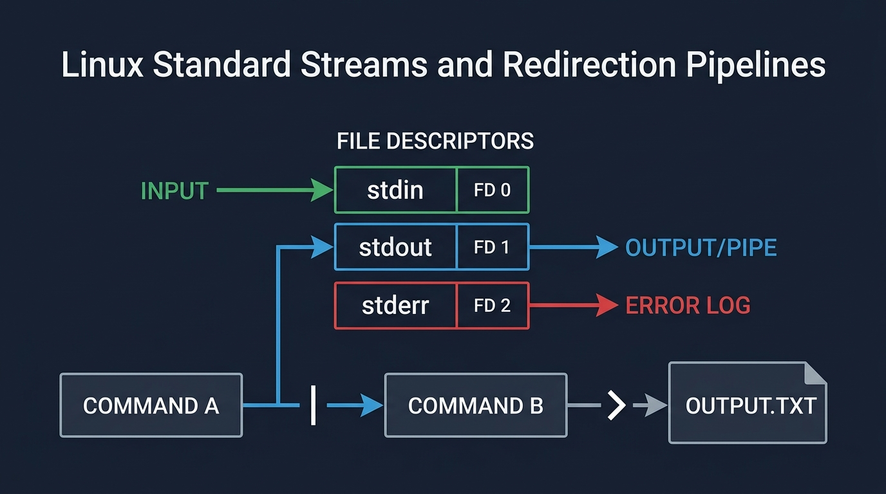
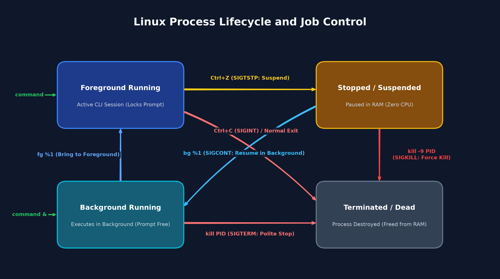

# Модуль 4: Консолидация базовых системных навыков, безопасности и сетей — Практическое руководство

Комплексное инженерное руководство, объединяющее навигацию по файловой системе Linux, анализ процессов, разграничение прав доступа, аудит сетевых сокетов и управление системными службами.

---

## 1. Четыре столпа системного администрирования Linux

Современное системное администрирование требует системной диагностики трех взаимосвязанных операционных уровней: активных процессов в оперативной памяти, учетных записей и прав доступа к файлам, а также сетевых сокетов, принимающих входящий трафик. При возникновении аварийной ситуации инженер последовательно проверяет каждый из этих уровней.

```text
+-----------------------------------------------------------------------------------+
| СТОЛП 1: НАВИГАЦИЯ ПО ФАЙЛОВОЙ СИСТЕМЕ, ПОИСК, АРХИВИРОВАНИЕ И ПОТОКИ            |
| Разрешение путей · Сравнение флагов (ls/grep) · Архивы (tar) · Перенаправление/tee |
+----------------------------------------+------------------------------------------+
                                         | Процесс запускается в контексте пользователя
                                         v
+-----------------------------------------------------------------------------------+
| СТОЛП 2: АНАЛИЗ ПРОЦЕССОВ, СИГНАЛЫ И УПРАВЛЕНИЕ ЗАДАНИЯМИ                         |
| Снимок процессов (ps) · Поиск (pgrep) · Эскалация сигналов (15/9) · Job Control   |
+----------------------------------------+------------------------------------------+
                                         | Процесс обращается к локальным файлам
                                         v
+-----------------------------------------------------------------------------------+
| СТОЛП 3: БЕЗОПАСНОСТЬ, ПРАВА ДОСТУПА DAC И ДЕЛЕГИРОВАНИЕ В SUDO                  |
| Правило обхода каталогов (r vs x) · Управление учетными записями · visudo -c      |
+----------------------------------------+------------------------------------------+
                                         | Процесс открывает сетевой сокет
                                         v
+-----------------------------------------------------------------------------------+
| СТОЛП 4: СОКЕТЫ ЯДРА, УПРАВЛЕНИЕ СЛУЖБАМИ В SYSTEMD И ВЕБ-СЕРВИСЫ                 |
| Сетевые сокеты (ss) · Анализ логов (journalctl) · Юниты Systemd · nc и curl       |
+-----------------------------------------------------------------------------------+
```

---

## 2. Столп 1: Навигация по файловой системе, поиск, архивирование и потоки

### 2.1 Иноды файлов и контекст обхода путей
Каждый объект файловой системы в Linux представлен структурой inode (индексным дескриптором), хранящей метаданные: идентификатор владельца (UID), идентификатор группы (GID), временные метки, размер файла и биты прав доступа. Иноды каталогов содержат записи (dirents), сопоставляющие имена файлов с номерами дочерних инодов. При обращении к любому вложенному файлу виртуальная файловая система (VFS) ядра проверяет права на выполнение (`x`) по всей цепочке каталогов от корня (`/`) до целевого объекта.

### 2.2 Механика флагов утилиты `ls`
Различные комбинации флагов определяют, отображает ли утилита `ls` имена файлов, метаданные инодов, атрибуты самих каталогов или списки, отсортированные по размеру.

| Вызов команды | Что отображается | Что скрыто / опущено | Применение в эксплуатации |
| :--- | :--- | :--- | :--- |
| `ls /var/www/html` | Только имена файлов в несколько колонок. | Скрытые dot-файлы, права доступа, владельцы, размеры, даты. | Быстрая визуальная проверка наличия файлов. |
| `ls -la /var/www/html` | Подробный список всех записей, включая `.` и `..`. | Ничего. Раскрывает скрытые файлы и права на каталоги. | Аудит безопасности и проверка владельцев файлов. |
| `ls -ld /var/www/html` | Подробные метаданные самого инода каталога. | Содержимое внутри каталога. | Проверка бита обхода каталога (`x`) и прав владельца. |
| `ls -lhS /var/log` | Подробный список, отсортированный по убыванию размера (`-S`). | Хронологический порядок файлов. | Поиск файлов, переполняющих дисковое пространство. |

Для проверки прав доступа самого каталога без вывода его содержимого используйте флаг `-ld`:
```bash
# Флаг '-l' выводит подробный список с правами, владельцами и размерами
# Флаг '-d' ограничивает проверку самим каталогом, не раскрывая его содержимое
ls -ld /var/www/html
```

### 2.3 Фильтрация текста с помощью `grep`
Анализ журналов на сервере требует точной фильтрации текста для отделения аномалий от информационного шума:
- `grep -i "шаблон"`: Игнорирует регистр символов (находит `error`, `Error` и `ERROR`).
- `grep -v "шаблон"`: Инвертирует условие поиска, исключая строки, соответствующие шаблону (полезно для отсечения регулярных проверок healthcheck).
- `grep -rnE "шаблон1|шаблон2"`: Рекурсивный поиск (`-r`), вывод номеров строк (`-n`) и использование расширенных регулярных выражений (`-E`) для поддержки логического оператора «ИЛИ» (`|`).

Для поиска критических ошибок по всем вложенным лог-файлам с выводом номеров строк выполните команду:
```bash
# Флаг '-r' выполняет поиск во всех вложенных каталогах
# Флаг '-n' выводит номер строки в исходном файле
# Флаг '-E' включает поддержку расширенных регулярных выражений для оператора 'ИЛИ' (|)
grep -rnE "WARN|CRITICAL" /var/log/
```

### 2.4 Поиск файлов в реальном времени и архивация (`find` и `tar`)
Утилита `find` обходит иерархию файловой системы в реальном времени, проверяя атрибуты инодов непосредственно на диске:
- `find <путь> -type f -name "*.log"`: Ограничивает поиск только обычными файлами с расширением `.log`.
- `find <путь> -type f -perm 777`: Находит небезопасные файлы с полным доступом для всех пользователей.

Для упаковки и проверки архивных копий диагностических логов без изменения исходных файлов используйте `tar`:
```bash
# Создание сжатого gzip-архива содержимого каталога
# Флаги: '-c' - создать; '-z' - сжатие gzip; '-v' - подробный вывод; '-f' - имя файла архива; '-C' - сменить каталог
tar -czvf /tmp/logs_archive.tar.gz -C /var/log .

# Просмотр оглавления архива без распаковки файлов на диск
# Флаги: '-t' - показать оглавление; '-z' - фильтр gzip; '-v' - подробно; '-f' - имя архива
tar -tzvf /tmp/logs_archive.tar.gz
```

### 2.5 Стандартные потоки и решение `sudo tee`
Каждый процесс при старте инициализирует три стандартных файловых дескриптора: `0` (`stdin`), `1` (`stdout`) и `2` (`stderr`).



#### Механика перенаправления
- `>` перезаписывает стандартный вывод (FD 1).
- `>>` дописывает стандартный вывод в конец файла (FD 1).
- `2>` перенаправляет поток стандартных ошибок (FD 2).
- `2>>` дописывает поток стандартных ошибок в конец файла (FD 2).
- `&>` направляет и стандартный вывод, и поток ошибок в один целевой файл (синтаксис Bash).
- `2>&1` дублирует дескриптор 2 в дескриптор 1, объединяя ошибки с обычным выводом (POSIX-стандарт).
- `<` перенаправляет стандартный ввод из файла в процесс (FD 0).
- `<<<` передает строку напрямую в стандартный ввод процесса (Here-String).
- `| tee -a` разветвляет поток: выводит на экран терминала и дописывает данные в файл.

Примеры использования операторов перенаправления потоков в повседневных задачах администрирования:
```bash
# Перезапись и последующее дописывание стандартного вывода
echo "Service started successfully" > /tmp/app.log
echo "Worker thread 1 active" >> /tmp/app.log

# Изоляция ошибок в отдельный файл и накопление журнала сбоев
ls /missing_directory 2> /tmp/errors.log
ls /another_invalid_path 2>> /tmp/errors.log

# Объединение потоков вывода и ошибок в общий журнал
ls /tmp /invalid_path &> /tmp/combined_bash.log
ls /tmp /invalid_path > /tmp/combined_posix.log 2>&1

# Подавление всего вывода для тихих фоновых проверок
/usr/bin/systemctl is-active nginx >/dev/null 2>&1

# Передача данных в стандартный ввод (wc: -l — подсчет количества строк; Here-String <<<)
wc -l < /tmp/app.log
tr '[:lower:]' '[:upper:]' <<< "critical failure detected"
```

#### Ловушка перенаправления с `sudo`
Типичная ошибка администратора возникает при попытке записи в защищенный файл через перенаправление с `sudo`:
```bash
# Эта команда завершается ошибкой: bash: /etc/app.conf: Permission denied
sudo echo "config_value=true" > /etc/app.conf
```
**Причина ошибки:** Оболочка командной строки открывает файл для записи (`> /etc/app.conf`) от имени непривилегированного пользователя *до* запуска команды `sudo`.

**Решение через `sudo tee`:** Утилита `tee` принимает данные из стандартного потока ввода и записывает их на диск. При передаче через конвейер в `sudo tee` операция записи выполняется процессом `tee`, запущенным с правами суперпользователя:
```bash
# Перезапись защищенного файла конфигурации с повышенными привилегиями
echo "config_value=true" | sudo tee /etc/app.conf

# Дописывание строки в защищенный файл без удаления существующего содержимого (tee: -a — режим append)
echo "debug=false" | sudo tee -a /etc/app.conf
```

#### Here-Documents: Кавычки в ограничителе
При записи многострочных конфигураций через конструкцию `cat << EOF`:
- `<< EOF` (без кавычек): Оболочка раскрывает переменные окружения (`$VAR`) и подстановки команд (`$(cmd)`).
- `<< 'EOF'` (с кавычками): Оболочка отключает подстановку переменных, сохраняя все строки буквально. Это необходимо при создании конфигураций Nginx, правил sudoers или bash-скриптов, содержащих знак `$`.

---

## 3. Столп 2: Анализ процессов, сигналы и управление заданиями

### 3.1 Состояния процессов в ядре Linux
Процесс в планировщике ядра Linux проходит через несколько стандартных состояний:
- **`R` (Running / Runnable):** Выполняется на процессорном ядре или ожидает очереди в планировщике.
- **`S` (Interruptible Sleep):** Ожидает события, таймера или завершения операции ввода-вывода. Просыпается при получении сигнала.
- **`D` (Uninterruptible Sleep):** Заблокирован в ожидании синхронного ввода-вывода (например, прямой записи на диск). Не может быть завершен ни одним сигналом, включая `SIGKILL`.
- **`Z` (Zombie / Defunct):** Завершил работу вызовом `exit()`, но родительский процесс еще не прочитал код возврата через `waitpid()`. Занимает запись в таблице процессов, но не потребляет оперативную память.



### 3.2 Стили отображения процессов: `ps aux`, `ps -ef` и `ps -eo`
Различные режимы вызова `ps` предоставляют специализированные диагностические срезы:
- **`ps aux` (стиль BSD):** Отображает процент использования памяти и процессора (`%CPU`, `%MEM`, `VSZ`, `RSS`), а также состояния процессов (`STAT`).
- **`ps -ef` (стиль POSIX):** Показывает иерархию процессов с идентификатором родительского процесса (`PPID`) и точным временем старта (`STIME`).
- **`ps -eo` (пользовательский DevOps-формат):** Формирует компактную структурированную таблицу с явно заданными колонками для автоматизации и локализации аномалий:

```bash
# Вывод процессов с наибольшим потреблением процессорного времени с кастомным набором полей
# Флаги: '-e' - все процессы; '-o' - выбор колонок; '--sort=-%cpu' - сортировка по убыванию CPU
ps -eo pid,ppid,user,%cpu,%mem,comm --sort=-%cpu | head -n 10
```

### 3.3 Точечный поиск процессов через `pgrep`
Вместо громоздких конвейеров `ps aux | grep worker | grep -v grep | awk '{print $2}'` используйте утилиту `pgrep`, обращающуюся напрямую к таблице процессов ядра:
```bash
# Поиск по полной командной строке (pgrep: -f — сопоставление со всей строкой аргументов, -l — показать имя процесса)
pgrep -fl "db_sync_worker"

# Получение чистого числового PID для автоматизации (pgrep: -f — сопоставление со всей командной строкой)
pgrep -f "db_sync_worker"
```

### 3.4 Протокол эскалации сигналов
Процессы обмениваются системными указаниями через сигналы POSIX. При аварийной остановке зависших сервисов инженеры строго соблюдают протокол ступенчатой эскалации:

```text
Мягкое завершение (SIGTERM: 15)  ---> Ожидание (2-5 сек) ---> Принудительное прерывание (SIGKILL: 9)
```

| Сигнал | Номер | Перехватываемый? | Назначение и инженерная логика |
| :--- | :--- | :--- | :--- |
| `SIGHUP` | `1` | Да | Обрыв терминальной сессии. Сетевые демоны используют его для безопасной перечитки конфигурации без сброса активных соединений. |
| `SIGINT` | `2` | Да | Прерывание с клавиатуры (`Ctrl+C`). Интерактивный запрос на завершение программы. |
| `SIGTERM` | `15` | Да | Стандартный сигнал корректного завершения. Дает процессу возможность сохранить состояние, сбросить файловые буферы на диск и закрыть сетевые соединения. |
| `SIGKILL` | `9` | **НЕТ** | Безусловная остановка ядра. Не может быть перехвачен, заблокирован или проигнорирован процессом. Ядро немедленно уничтожает адресное пространство процесса. |

Для корректной остановки процесса сначала отправьте `SIGTERM`, выдержите небольшую паузу, проверьте наличие PID в таблице процессов и отправляйте `SIGKILL` только при отсутствии реакции:
```bash
# Шаг 1: Отправка запроса на корректное завершение процесса (kill: -15 — сигнал SIGTERM для штатной остановки)
kill -15 2840

# Шаг 2: Пауза для сброса файловых буферов и корректного закрытия
sleep 2

# Шаг 3: Проверка наличия процесса в таблице ядра (ps: -p — фильтрация по конкретному PID)
ps -p 2840

# Шаг 4: Принудительное уничтожение процесса ядром при отсутствии реакции (kill: -9 — безусловный сигнал SIGKILL)
kill -9 2840
```

### 3.5 Управление фоновыми заданиями (Job Control)
При выполнении длительных административных задач в интерактивной оболочке:
- Добавление `&` в конце команды запускает процесс в фоновом режиме текущей оболочки.
- `jobs -l`: Отображает список активных фоновых заданий с номерами заданий и соответствующими PID.
- `fg %1`: Переводит фоновое задание номер 1 на передний план терминала.
- `Ctrl+Z`: Приостанавливает текущую программу на переднем плане (переводя процесс в состояние `STOP`).
- `bg %1`: Возобновляет выполнение приостановленного задания номер 1 в фоновом режиме.
- `nohup <команда> > file.log 2>&1 &`: Защищает запущенный процесс от сигнала обрыва сессии `SIGHUP`, гарантируя продолжение работы после отключения от SSH.

---

## 4. Столп 3: Безопасность, права доступа DAC и делегирование в Sudo

### 4.1 Дискреционный контроль доступа (DAC) и восьмеричные маски
Каждый файл и каталог в Linux обладает 9 базовыми битами прав, разделенными на три категории пользователей:
- **Владелец (`u`):** Учетная запись, создавшая объект или назначенная его владельцем.
- **Группа (`g`):** Участники группы, закрепленной за объектом.
- **Остальные (`o`):** Все остальные аутентифицированные пользователи системы.

Для каждой категории оцениваются три бита доступа: Чтение (`r` = 4), Запись (`w` = 2) и Выполнение (`x` = 1).

| Восьмеричный | Символьный | Применимый объект | Назначение и принцип наименьших привилегий |
| :--- | :--- | :--- | :--- |
| `755` | `rwxr-xr-x` | Каталоги и исполняемые файлы | Полный доступ владельцу; группа и остальные могут читать и входить в каталог. Стандарт для публичных веб-директорий. |
| `750` | `rwxr-x---` | Каталоги проектных команд | Полный доступ владельцу; группа может читать и входить; остальным пользователям доступ полностью закрыт. |
| `644` | `rw-r--r--` | Конфигурации и публичные файлы | Владелец читает и записывает; группа и остальные только читают. Стандарт для большинства файлов конфигурации. |
| `640` | `rw-r-----` | Конфиденциальные данные и логи | Владелец читает и пишет; группа только читает; остальным доступ запрещен. |
| `440` | `r--r-----` | Файлы правил в `/etc/sudoers.d/` | Чтение для root и группы shadow; запись запрещена всем. Sudo игнорирует файлы с избыточными правами. |

### 4.2 Закон обхода каталогов (The Directory Traversal Law)
Назначение битов прав принципиально различается для обычных файлов и для каталогов:

| Бит доступа | Функция для обычного файла | Функция для узла каталога |
| :--- | :--- | :--- |
| **Чтение (`r`)** | Чтение содержимого файла (`cat`, `less`). | Получение списка имен файлов в каталоге (`ls`). |
| **Запись (`w`)** | Изменение содержимого файла. | Создание, переименование и удаление файлов внутри каталога. |
| **Выполнение (`x`)** | Запуск файла как программы или скрипта. | **Обход и поиск.** Вход в каталог (`cd`), доступ к метаданным инодов и открытие файлов (`cat /dir/file`). |

> [!IMPORTANT]
> **Правило обхода каталогов:** Чтобы прочитать файл по пути `/a/b/c.txt`, пользователь обязан иметь **бит выполнения (`x`)** на каждом родительском каталоге в цепочке пути (`/`, `/a`, `/a/b`). Если хотя бы на одном промежуточном каталоге бит `x` отсутствует, ядро вернет ошибку `Permission denied`, даже если на самом целевом файле установлены права `chmod 777`!

Для проверки всей цепочки прав на каталоги по пути к файлу используйте утилиту `namei`:
```bash
# Проверка прав доступа и владельцев по всей цепочке (namei: -l — подробный вывод прав)
namei -l /opt/shared_app/config.env
```

### 4.3 Управление пользователями и группами
Учетные записи и группы обеспечивают изоляцию системных служб и участников команд:
- `sudo groupadd <группа>`: Создает системную группу.
- `sudo useradd -m -s /bin/bash <пользователь>`: Создает учетную запись с домашним каталогом (`-m`) и оболочкой bash (`-s`).
- `sudo usermod -aG <группа> <пользователь>`: Добавляет пользователя в дополнительную группу (флаг `-a` обязателен, иначе все неперечисленные группы будут сброшены!).
- `id <пользователь>`: Проверяет UID, основной GID и список дополнительных групп.
- `sudo userdel -r <пользователь>`: Удаляет учетную запись вместе с домашним каталогом.

### 4.4 Делегирование привилегий через Sudoers и проверка синтаксиса
Вместо раздачи неограниченного парольного доступа к root в production-окружениях права делегируются точечно через конфигурационные drop-in файлы в каталоге `/etc/sudoers.d/`:

```text
# Формат правила:
<ПОЛЬЗОВАТЕЛЬ/ГРУППА> <ХОСТ> = (<ОТ_ИМЕНИ>) NOPASSWD: <АБСОЛЮТНЫЙ_ПУТЬ_К_БИНАРНИКУ>
```

Для выдачи прав инженеру на перезапуск и перечитку Nginx без запроса пароля создайте правило, установите права `440` и выполните проверку:
```bash
# Шаг 1: Создание точечного правила делегирования прав через Here-Document
cat << 'EOF' | sudo tee /etc/sudoers.d/dev_alex_nginx >/dev/null
dev_alex ALL=(root) NOPASSWD: /usr/bin/systemctl restart nginx, /usr/bin/systemctl reload nginx
EOF

# Шаг 2: Установка строгого режима 440 (sudo блокирует файлы с правами на запись)
sudo chmod 440 /etc/sudoers.d/dev_alex_nginx

# Шаг 3: Проверка синтаксиса всех файлов sudoers перед завершением сессии (visudo: -c — проверка синтаксиса)
sudo visudo -c

# Шаг 4: Проверка разрешенных привилегированных команд (sudo: -u — от имени dev_alex, -l — список прав)
sudo -u dev_alex sudo -l
```

---

## 5. Столп 4: Сокеты ядра, управление службами в Systemd и веб-сервисы

### 5.1 Анализ сетевых сокетов ядра с помощью `ss -tunlp`
Сетевой сокет связывает внешний сетевой пакет с локальным процессом операционной системы. Утилита `ss` опрашивает структуры данных сокетов в ядре:
- `-t`: Фильтрация TCP-сокетов.
- `-u`: Фильтрация UDP-сокетов.
- `-n`: Числовой вывод IP-адресов и портов (отключает медленные обратные DNS-запросы).
- `-l`: Только слушающие сокеты в состоянии `LISTEN` (скрывает временные клиентские соединения).
- `-p`: Отображение имени процесса и его PID (требует прав `sudo`).

```bash
# Просмотр слушающих сокетов ядра с фильтрацией (ss: -t — TCP, -u — UDP, -n — числовые порты, -l — слушающие, -p — показать PID и процесс)
sudo ss -tunlp | grep :80
```

#### Адреса привязки сокетов (Socket Bind)
- **`0.0.0.0:80`:** Прием входящих подключений на всех доступных сетевых интерфейсах IPv4.
- **`127.0.0.1:80`:** Прием подключений только на локальном петлевом интерфейсе (недоступен из внешней сети).
- **`[::]:80`:** Прием подключений на всех интерфейсах IPv6 (а также IPv4 при включенном dual-stack).

### 5.2 Многоуровневое сетевое тестирование: Уровень 4 (`nc`) против Уровня 7 (`curl`)
Диагностика сетевых отказов требует раздельной проверки транспортного соединения и протокола приложения:
- **Транспортный уровень 4 (`nc -zv`):** Проверяет завершение 3-стороннего TCP-рукопожатия (`SYN`-`SYN-ACK`-`ACK`). Флаги: `-z` (сканирование без передачи данных), `-v` (подробный вывод).
- **Прикладной уровень 7 (`curl -I`):** Отправляет HTTP HEAD-запрос для проверки кода статуса ответа веб-сервера и служебных заголовков.

Для определения причины сбоя (закрыт сетевой порт или аварийно завершилось веб-приложение) выполните оба теста:
```bash
# Проверка сетевой доступности порта на 4 уровне TCP (nc: -z — режим сканирования без данных, -v — подробный вывод verbose)
nc -zv 127.0.0.1 80

# Проверка ответа веб-сервера на 7 уровне HTTP (curl: -I — отправка метода HEAD, только заголовки)
curl -I http://127.0.0.1:80
```

### 5.3 Автоматизированные проверки healthcheck с помощью `curl`
Для скриптов мониторинга полезно извлекать только числовой код HTTP-статуса без HTML-разметки:
```bash
# Вывод только числового HTTP-статуса ответа сервера (curl: -s — тихий режим silent, -o /dev/null — отбросить тело, -w — форматированный вывод статуса)
curl -s -o /dev/null -w "%{http_code}\n" http://127.0.0.1:80
```

Для замера сетевых задержек и времени отклика бэкенда:
```bash
# Замер ключевых метрик времени сети и TTFB (curl: -s — тихий режим silent, -o /dev/null — подавить тело, -w — шаблон вывода таймингов)
curl -s -o /dev/null -w "HTTP Status: %{http_code}\nDNS Lookup: %{time_namelookup}s\nTCP Connect: %{time_connect}s\nTTFB: %{time_starttransfer}s\nTotal: %{time_total}s\n" http://127.0.0.1:80
```

### 5.4 Жизненный цикл служб Systemd и маскирование юнитов
Менеджер служб Systemd управляет фоновыми сервисами через файлы юнитов:
- `sudo systemctl status <юнит>`: Просмотр состояния, PID главного процесса, потребления памяти и последних записей логов.
- `sudo systemctl restart <юнит>`: Полная остановка и повторный запуск демона (сопровождается кратковременным разрывом соединений).
- `sudo systemctl reload <юнит>`: Отправка сигнала `SIGHUP` для перечитывания файлов конфигурации без простоя сервиса.
- `systemctl is-active <юнит>`: Возвращает код выхода `0` и строку `active`, если служба работает штатно.

#### Маскирование служб (`systemctl mask`)
При маскировании юнита (`sudo systemctl mask <юнит>`) Systemd создает символическую ссылку на `/dev/null`:
```text
/etc/systemd/system/nginx.service -> /dev/null
```
Это самая жесткая блокировка в Systemd: службу **невозможно запустить вручную, она не запустится при загрузке системы и не сможет быть активирована зависимыми сокетами или сервисами**.

Для восстановления замаскированной службы:
```bash
# Удаление символической ссылки на /dev/null
sudo systemctl unmask nginx

# Перечитка конфигурационных файлов менеджера systemd с диска
sudo systemctl daemon-reload

# Запуск службы и проверка ее рабочего состояния
sudo systemctl restart nginx
systemctl is-active nginx
```

### 5.5 Журналирование Systemd (`journalctl -xeu`)
При падении службы запросите системный журнал для выяснения причины аварии:
```bash
# Флаги: '-x' - каталожные пояснения; '-e' - переход в конец лога; '-u' - фильтрация по юниту; '--no-pager' - вывод в терминал
sudo journalctl -xeu nginx --no-pager
```

---

## 6. Регламенты устранения типовых инцидентов (Playbooks)

### Сценарий 1: Зависший фоновый процесс и эскалация сигналов
**Симптомы:** Фоновый расчетный процесс ушел в бесконечный цикл и утилизирует 100% процессора.

```bash
# Шаг 1: Поиск процессов с наибольшей нагрузкой на процессор (ps: -e — все, -o — выбор полей, --sort=-%cpu — сортировка; head: -n 5 — первые 5)
ps -eo pid,ppid,user,%cpu,comm --sort=-%cpu | head -n 5

# Шаг 2: Получение точного PID через pgrep (pgrep: -f — со всей строкой аргументов, -l — показать имя процесса)
pgrep -fl "worker"

# Шаг 3: Отправка корректного сигнала остановки (kill: -15 — сигнал SIGTERM для корректного завершения)
kill -15 <PID>
sleep 2

# Шаг 4: Проверка удаления процесса из таблицы ядра (ps: -p — фильтрация по конкретному PID)
ps -p <PID>

# Шаг 5: Принудительное уничтожение при отсутствии реакции (kill: -9 — безусловный сигнал SIGKILL)
kill -9 <PID>
```

### Сценарий 2: Ошибка обхода каталогов (отсутствие бита `+x`)
**Симптомы:** Веб-сервер возвращает ошибку `403 Forbidden` или `Permission denied` при попытке чтения файла с правами `644`.

```bash
# Шаг 1: Аудит всей цепочки прав на каталоги по пути к файлу (namei: -l — подробный вывод прав)
namei -l /var/www/html/index.html

# Шаг 2: Проверка наличия бита 'x' на промежуточном каталоге (ls: -l — длинный формат, -d — каталог без содержимого)
ls -ld /var/www/html

# Шаг 3: Добавление обязательного бита выполнения на каталог (chmod: 755 — rwxr-xr-x)
sudo chmod 755 /var/www/html

# Шаг 4: Проверка возможности чтения файла служебным пользователем (sudo: -u www-data — запуск от имени веб-сервера)
sudo -u www-data cat /var/www/html/index.html > /dev/null
```

### Сценарий 3: Конфликт привязки сокетов ("Address Already in Use", Errno 98)
**Симптомы:** Nginx не может запуститься, так как TCP-порт 80 занят сторонним приложением.

```bash
# Шаг 1: Проверка ошибки привязки порта в журнале (journalctl: -x — каталог пояснений, -e — в конец, -u — юнит nginx, --no-pager — без less)
sudo journalctl -xeu nginx --no-pager | grep "Address already in use"

# Шаг 2: Определение PID процесса, захватившего сокет (ss: -t — TCP, -u — UDP, -n — числовые порты, -l — слушающие, -p — показать PID и процесс)
sudo ss -tunlp | grep :80

# Шаг 3: Остановка конфликтующего процесса (kill: -9 — безусловный сигнал SIGKILL)
sudo kill -9 <PID_ПРОЦЕССА>

# Шаг 4: Запуск Nginx и проверка статуса
sudo systemctl start nginx
systemctl is-active nginx
```

### Сценарий 4: Восстановление замаскированной службы Systemd
**Симптомы:** Попытка запуска службы завершается ошибкой `Unit nginx.service is masked`.

```bash
# Шаг 1: Проверка замаскированного состояния юнита
systemctl status nginx

# Шаг 2: Снятие маскировки службы
sudo systemctl unmask nginx

# Шаг 3: Перечитка конфигурации менеджера systemd
sudo systemctl daemon-reload

# Шаг 4: Сброс счетчиков ошибок юнита
sudo systemctl reset-failed nginx

# Шаг 5: Запуск службы и проверка рабочего состояния
sudo systemctl start nginx
systemctl is-active nginx
```

---

## 7. Методология поиска неисправностей снаружи внутрь (Outside-In)

При локализации аварий на продуктовых серверах следуйте системной диагностической модели **снаружи внутрь**: от внешнего клиентского запроса до прав на локальной файловой системе:

```text
1. ПРОВЕРКА КЛИЕНТОМ (Прикладной уровень 7):
   curl -I http://<IP_СЕРВЕРА>:80
   Возвращает ли сервер HTTP 200 OK, ошибку протокола (502/403) или таймаут соединения?
           |
           v
2. ПРОВЕРКА ТРАНСПОРТНОГО СОЕДИНЕНИЯ (Уровень 4):
   nc -zv <IP_СЕРВЕРА> 80
   Завершается ли 3-стороннее рукопожатие TCP (open) или соединение сброшено (refused/timeout)?
           |
           v
3. СЛУШАЮЩИЕ СОКЕТЫ ЯДРА:
   sudo ss -tunlp | grep :80
   Открыт ли сокет на 80-м порту? Какой PID и процесс владеет сокетом?
           |
           v
4. СОСТОЯНИЕ И ЖИЗНЕННЫЙ ЦИКЛ СЛУЖБЫ:
   sudo systemctl status nginx
   В каком состоянии юнит: active, inactive, failed или masked?
           |
           v
5. ВАЛИДАЦИЯ КОНФИГУРАЦИОННЫХ ФАЙЛОВ:
   sudo nginx -t
   Есть ли синтаксические ошибки в файлах конфигурации веб-сервера?
           |
           v
6. СИСТЕМНЫЕ ЛОГИ И ОШИБКИ ЯДРА:
   sudo journalctl -xeu nginx --no-pager
   Какая точная системная ошибка или исключение вызвали падение?
           |
           v
7. ФАЙЛОВАЯ СИСТЕМА И ПРАВА ОБХОДА:
   namei -l /var/www/html/index.html
   Имеет ли демон веб-сервера биты обхода 'x' на всех родительских каталогах?
```
