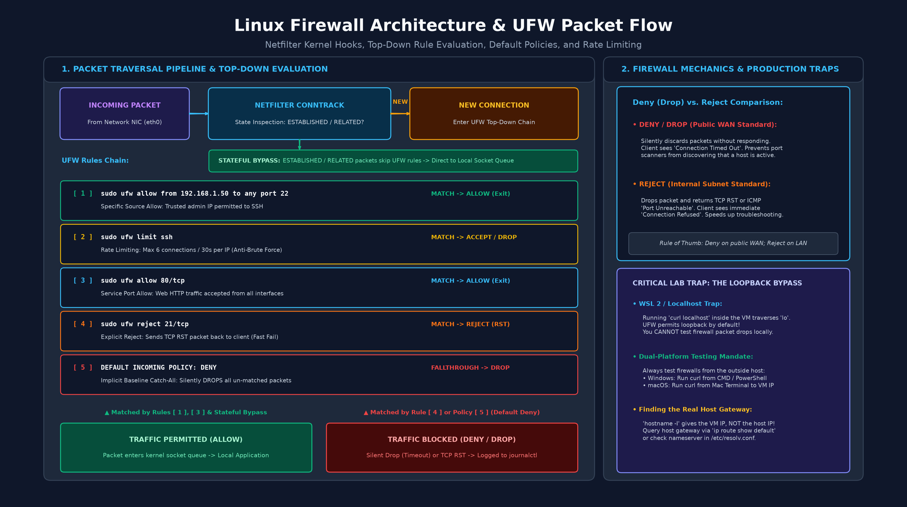
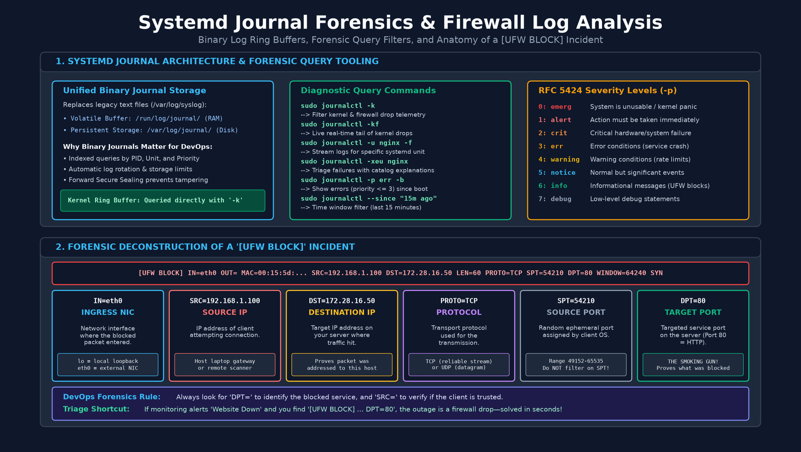
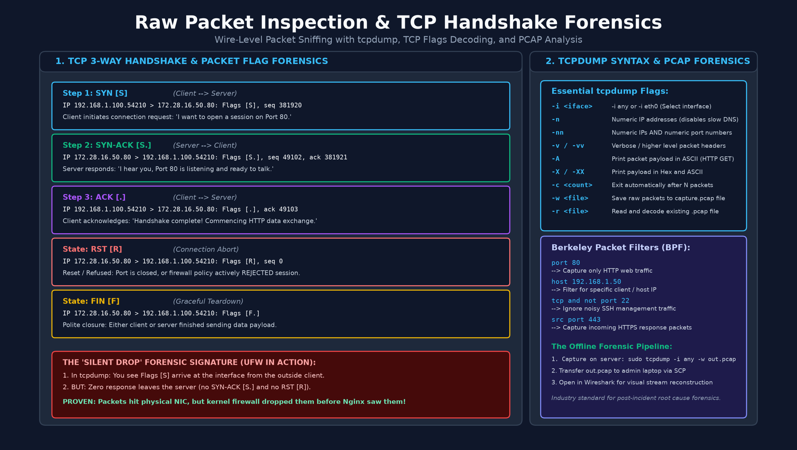

# Модуль 5: Диагностика, защита и логи — Раздаточный материал для студента

Комплексное инженерное руководство по защите сетевого периметра хоста Linux с помощью UFW, расследованию инцидентов по системным журналам systemd и низкоуровневому анализу сетевых пакетов через tcpdump.

---

## 1. Архитектура фаервола Linux и стек Netfilter

Межсетевые экраны в Linux функционируют непосредственно на уровне ядра операционной системы. Понимание различий между подсистемой фильтрации пакетов в ядре и утилитами управления пользовательского пространства (userspace) критически важно для проектирования надежных систем.



### 1.1 Стек ядра и утилиты пользовательского пространства

- **Netfilter (пространство ядра / Kernel Space):** Встроенный в ядро Linux механизм фильтрации пакетов и трансляции сетевых адресов (NAT). Каждый входящий, проходящий транзитом или исходящий сетевой пакет активирует хуки Netfilter (`PREROUTING`, `INPUT`, `FORWARD`, `OUTPUT`, `POSTROUTING`).
- **iptables / nftables (движки пользовательского пространства):** Низкоуровневые утилиты командной строки, используемые для определения таблиц, цепочек и правил сопоставления пакетов внутри Netfilter. Несмотря на гибкость, их ручной синтаксис сложен и чреват ошибками.
- **UFW (Uncomplicated Firewall):** Высокоуровневый административный интерфейс, разработанный для систем Debian и Ubuntu. UFW транслирует простые команды администратора (например, `allow ssh`) в корректные и безопасные наборы правил iptables и nftables.

> [!NOTE]
> В облачных инфраструктурах (AWS EC2, Google Cloud Compute Engine, Яндекс Облако) группы безопасности (Security Groups) обеспечивают внешний виртуальный периметр. Однако концепция эшелонированной обороны (Defense-in-Depth) требует обязательного включения локального фаервола (UFW/nftables) внутри каждой виртуальной машины, чтобы исключить боковое перемещение злоумышленников (lateral movement) при компрометации соседнего узла в приватной подсети.

### 1.2 Фильтрация с контролем состояния (Stateful Inspection)

UFW опирается на подсистему отслеживания соединений ядра Netfilter (`conntrack`):
- **Контроль состояния (Stateful Tracking):** Фаервол отслеживает активные двунаправленные сессии, анализируя порядковые номера TCP (sequence numbers), эфемерные порты и пары запросов-ответов ICMP.
- **Автоматический пропуск обратного трафика:** Когда локальный клиент или сервис инициирует исходящее соединение (например, при вызове `apt update` или `curl https://example.com`), ядро регистрирует исходящий поток. Входящие ответные пакеты, соответствующие установленному соединению, пропускаются автоматически. Администратору не требуется открывать диапазоны эфемерных портов для входящих ответов.

---

## 2. Настройка периметра с помощью UFW

Продакшен-фаервол должен реализовывать строгий базовый принцип **Default Deny** (запрет по умолчанию): любой неразрешенный входящий трафик отбрасывается, если для него нет явного разрешающего правила.

### 2.1 Базовые политики безопасности

Настройте базовый профиль безопасности, блокируя все входящие запросы и разрешая исходящие соединения, инициированные локальной системой:

```bash
# Установка базовой политики: сброс всего входящего несанкционированного трафика
# 'default deny incoming': переводит цепочку INPUT в режим DROP для всех не запрошенных изнутри пакетов
sudo ufw default deny incoming

# Установка базовой политики: разрешение всех исходящих соединений, созданных системой
# 'default allow outgoing': переводит цепочку OUTPUT в режим ACCEPT для локально сгенерированного трафика
sudo ufw default allow outgoing
```

> [!CAUTION]
> На удаленных серверах (в облаке или на headless-виртуальных машинах) никогда не включайте UFW до явного добавления разрешающего правила для SSH (`sudo ufw allow ssh` или `sudo ufw allow 22/tcp`). Включение фаервола без открытого порта SSH приведет к мгновенной и безвозвратной потере сессии административного доступа.

### 2.2 Синтаксис правил для служб и портов

Правила могут ссылаться на стандартные имена служб из базы данных `/etc/services` или на явные комбинации номеров портов и протоколов:

Разрешите входящий трафик для административного доступа по SSH, стандартного протокола HTTP и защищенного HTTPS с явным указанием транспортного протокола:

```bash
# Разрешение входящего SSH по имени службы (преобразуется в порт 22/tcp через /etc/services)
sudo ufw allow ssh

# Разрешение HTTP и HTTPS с явным указанием числового порта и транспортного протокола
# '<port>/<protocol>': привязывает правило строго к TCP, оставляя UDP закрытым
sudo ufw allow 80/tcp
sudo ufw allow 443/tcp

# Разрешение непрерывного диапазона портов для UDP-сервисов
# '<start>:<end>/udp': создает единое правило Netfilter, охватывающее весь интервал портов
sudo ufw allow 60000:61000/udp
```

### 2.3 Гранулярный контроль доступа и подсети

В продакшен-средах соблюдается **принцип наименьших привилегий** (Principle of Least Privilege): доступ к административным портам и базам данных ограничивается доверенными IP-адресами или внутренними подсетями:

Ограничьте административный доступ по SSH и доступ к порту базы данных доверенной рабочей станцией и внутренней подсетью приложений:

```bash
# Разрешение SSH строго с одного доверенного IP-адреса администратора
# 'from 192.0.2.45': исходный IP; 'to any': локальные интерфейсы сервера
# 'port 22': целевой порт; 'proto tcp': протокол TCP
sudo ufw allow from 192.0.2.45 to any port 22 proto tcp

# Разрешение доступа к PostgreSQL строго из внутренней подсети приложений
# 'from 10.0.4.0/24': разрешает любой хост в диапазоне 10.0.4.1–10.0.4.254
# 'port 5432': стандартный порт службы PostgreSQL
sudo ufw allow from 10.0.4.0/24 to any port 5432 proto tcp

# Ограничение входящего трафика на конкретном физическом или виртуальном сетевом интерфейсе
# 'in on eth1': обрабатывает пакеты, поступившие строго на интерфейс eth1, игнорируя eth0 и lo
sudo ufw allow in on eth1 to any port 8080 proto tcp
```

### 2.4 Ограничение частоты соединений (`ufw limit`)

Для защиты общедоступных служб аутентификации от атак методом перебора паролей (brute-force) UFW предоставляет встроенный механизм троттлинга:

Примените ограничение частоты входящих подключений на порт SSH для автоматической защиты от атак перебора паролей:

```bash
# Включение троттлинга соединений на порт аутентификации SSH
# 'limit': динамически блокирует IP-адреса, инициирующие 6 и более попыток подключения за 30 секунд
# 'ssh/tcp': целевая служба SSH на порту 22/tcp
sudo ufw limit ssh/tcp
```

**Логика работы троттлинга:** Если определенный IP-адрес инициирует 6 или более попыток подключения в течение 30-секундного окна, фаервол автоматически сбрасывает все последующие пакеты с этого адреса до истечения интервала.

### 2.5 Различие между Deny (DROP) и Reject

| Директива | Действие ядра | Наблюдение клиента | Рекомендуемая среда |
| :--- | :--- | :--- | :--- |
| **`deny` (DROP)** | Молча отбрасывает пакет без отправки ответа клиенту. | Соединение зависает до истечения тайм-аута приложения (`Connection timed out`). | Публичные внешние интерфейсы (WAN); скрывает факт наличия сервера от сканеров. |
| **`reject`** | Отбрасывает пакет и немедленно отправляет TCP RST или ICMP Port Unreachable. | Мгновенный сброс и ошибка соединения (`Connection refused`). | Внутренние подсети (LAN/VPC); обеспечивает быстрый отказ (fail-fast) и оперативную отладку. |

Настройте правила молчаливого сброса (deny) и активного отклонения (reject) для устаревших или неиспользуемых протоколов:

```bash
# Молчаливый сброс входящих пакетов на порт 23 (Telnet)
# 'deny': действие DROP отбрасывает пакет без ответа; сканер злоумышленника зависает по тайм-ауту
sudo ufw deny 23/tcp

# Активное отклонение входящих пакетов на порт 21 (FTP)
# 'reject': действие REJECT немедленно возвращает пакет TCP RST или ICMP Port Unreachable для мгновенного завершения
sudo ufw reject 21/tcp
```

### 2.6 Порядок обработки правил (`ufw insert`)

Netfilter обрабатывает правила межсетевого экрана последовательно сверху вниз по принципу **первого совпадения** (First-Match). Как только пакет подпадает под условие правила, действие выполняется немедленно, а остальные правила игнорируются:

Вставьте правило запрета с наивысшим приоритетом на позицию 1, чтобы заблокировать скомпрометированный IP-адрес до проверки разрешающих правил:

```bash
# Вставка блокирующего правила в начало цепочки с индексом 1
# 'insert 1': помещает правило на первую позицию; пакет атакующего блокируется до проверки разрешающих правил
# 'deny from 198.51.100.25': целевой IP атакующего; 'to any': блокировка ко всем локальным портам
sudo ufw insert 1 deny from 198.51.100.25 to any
```

---

## 3. Логирование фаервола и кольцевой буфер ядра

При блокировке пакета Netfilter формирует структурированное сообщение аудита и записывает его в кольцевой буфер сообщений ядра (`/dev/kmsg`).

### 3.1 Включение телеметрии межсетевого экрана

Настройте уровень детализации журнала UFW, чтобы заголовки заблокированных пакетов сохранялись в системных логах для диагностики:

```bash
# Установка уровня логирования medium для захвата метаданных заблокированных пакетов
# 'medium': логирует все заблокированные пакеты (согласно политикам), невалидные пакеты и новые сессии
sudo ufw logging medium
```

### 3.2 Что попадает в лог с меткой `[UFW BLOCK]`, а что нет

Запись событий в лог зависит от цепочки завершения пакета и наличия явных правил:

- **Блокировки базовой политикой (`[UFW BLOCK]` записывается):** Нежелательные пакеты, пришедшие на порты без явных разрешающих правил (например, порт 9999), проходят весь пользовательский набор правил без совпадений. Они попадают в цепочку политики по умолчанию (`ufw-after-logging-input`), которая автоматически фиксирует `[UFW BLOCK]` перед сбросом.
- **Явные правила Deny / Reject (по умолчанию работают без логов):** Если правило добавлено без ключевого слова `log` (например, `sudo ufw deny 8080` или `sudo ufw reject 8081`), UFW сбрасывает пакет в пользовательской цепочке (`ufw-user-input`). На стандартном уровне `low` пользовательские правила не генерируют записей. Чтобы включить аудит для конкретного правила, указывайте директиву `log` при создании (`sudo ufw deny log 8080/tcp`).
- **Разрешенный трафик (не блокируется):** Пакеты, удовлетворяющие активным правилам `allow`, принимаются системой и не создают записей `[UFW BLOCK]`.

### 3.3 Анатомия лога `[UFW BLOCK]`

Событие блокировки ядра содержит структурированные сетевые метаданные:

```text
[UFW BLOCK] IN=eth0 OUT= MAC=00:15:5d:01:02:03 SRC=192.0.2.100 DST=172.28.16.50 LEN=60 TOS=0x00 PREC=0x00 TTL=64 ID=41235 DF PROTO=TCP SPT=54210 DPT=9090 WINDOW=64240 RES=0x00 SYN URGP=0
```

- **`IN`:** Сетевой интерфейс, на который поступил пакет (`eth0`).
- **`SRC`:** Исходный IP-адрес отправителя (`192.0.2.100`).
- **`DST`:** Целевой IP-адрес на локальном хосте (`172.28.16.50`).
- **`PROTO`:** Протокол транспортного уровня (`TCP` или `UDP`).
- **`SPT`:** Исходный порт (Source Port, эфемерный порт клиента, выделенный ОС, например `54210`).
- **`DPT`:** Целевой порт (Destination Port, порт целевой службы, например `9090`).
- **`SYN`:** Флаг TCP, указывающий на попытку инициализации нового рукопожатия соединения.

---

## 4. Расследование инцидентов по журналам Systemd (`journalctl`)

Система инициализации systemd собирает телеметрию ядра и сервисов в единый индексированный бинарный журнал, управляемый службой `systemd-journald`.



### 4.1 Источники телеметрии: что доступно через `journalctl`

Служба `systemd-journald` служит единой точкой сбора данных для мониторинга хоста, перехватывая и индексируя логи множества подсистем:

- **Телеметрия подсистемы ядра (`/dev/kmsg` через ключ `-k`):**
  - События сброса пакетов межсетевым экраном Netfilter (`[UFW BLOCK]`)
  - Принудительное завершение процессов механизмом Out-of-Memory (OOM Killer)
  - Ошибки ввода-вывода блочных устройств, тайм-ауты дисков и перемонтирование файловых систем в режим read-only
  - Сбои драйверов оборудования и переключения состояний физических и виртуальных сетевых интерфейсов
- **Системные службы и стандартные потоки демонов (`-u <unit>`):**
  - Смена состояний жизненного цикла юнитов (`Starting`, `Started`, `Reloading`, `Deactivated`, `Failed`)
  - Стандартный вывод (`stdout`) и поток ошибок (`stderr`), порождаемые сервисами
  - Ошибки синтаксиса конфигурационных файлов и аварийные завершения процессов
- **События безопасности, аутентификации и аудита:**
  - Попытки аутентификации демона SSH (`Accepted password`, `Failed password for invalid user`)
  - Вызовы административных команд через утилиту `sudo`
  - Создание пользовательских сессий и регистрация в терминалах через `systemd-logind`
- **Анализ сбоев и перезагрузок системы (`-b`, `-b -1`):**
  - Хранение логов предыдущих загрузок для выявления причин внезапных перезагрузок или падений ядра (Kernel Panic)
  - Профилирование времени старта служб и этапов инициализации хоста

### 4.2 Практические сценарии фильтрации логов

#### 1. Телеметрия ядра и проверка фаервола

Запросите кольцевой буфер ядра для анализа блокировок фаервола и аппаратных ошибок без шума от пользовательских приложений:

```bash
# Запрос последних 20 событий блокировки фаервола из кольцевого буфера ядра
# '-k': фильтрует сообщения от ядра Linux (/dev/kmsg)
# '-n 20': выводит только последние 20 записей
# '--no-pager': направляет вывод напрямую в stdout без открытия интерактивного less
sudo journalctl -k -n 20 --no-pager | grep "UFW BLOCK"

# Потоковый просмотр событий ядра в реальном времени при поступлении сетевых пакетов
# '-k': только события ядра; '-f' (--follow): непрерывно отображает новые строки
sudo journalctl -kf

# Фильтрация сообщений ядра об ошибках оборудования или драйверов за текущую загрузку
# '-k': сообщения ядра; '-p err': уровень важности 3 (Error) и выше; '-b': только текущая загрузка
sudo journalctl -k -p err -b --no-pager
```

#### 2. Фильтрация по уровням важности (Priority Filtering)

Стандарт Syslog определяет 8 уровней приоритета (0=`emerg`, 1=`alert`, 2=`crit`, 3=`err`, 4=`warning`, 5=`notice`, 6=`info`, 7=`debug`). Отфильтруйте общесистемные журналы для быстрого выявления критических сбоев во время аварий:

```bash
# Вывод только ошибок и критических сообщений всех служб с момента последней загрузки
# '-p err': фильтрует приоритеты syslog от 3 (err) до 0 (emerg); '-b': ограничивает текущей загрузкой
sudo journalctl -p err -b --no-pager

# Выборка предупреждений и ошибок по всей системе за последний час
# '-p warning..err': диапазон важности от 4 (warning) до 3 (err); '--since': временная граница
sudo journalctl -p warning..err --since "1 hour ago" --no-pager
```

#### 3. Поиск событий в заданном временном окне

Ограничьте вывод журнала точным интервалом инцидента, используя формат ISO 8601 или понятные относительные смещения:

```bash
# Запрос логов строго в рамках исторического окна зафиксированного сбоя
# '--since' / '--until': временные метки ISO 8601, задающие точные границы начала и конца инцидента
sudo journalctl --since "2026-09-16 10:00:00" --until "2026-09-16 10:30:00" --no-pager

# Вывод системных записей, созданных за последние 30 минут
# '--since "30m ago"': относительное временное смещение назад от текущего момента
sudo journalctl --since "30m ago" --no-pager
```

#### 4. Диагностика сервисов и корреляция логов нескольких юнитов

Изолируйте сообщения конкретного демона или сопоставьте журналы нескольких взаимосвязанных служб в едином потоке:

```bash
# Фильтрация записей конкретного системного юнита за последние 15 минут
# '-u nginx.service': изолирует события указанного юнита systemd
# '--since "15 minutes ago"': ограничивает выборку последними 15 минутами; '--no-pager': без запуска пейджера
sudo journalctl -u nginx.service --since "15 minutes ago" --no-pager

# Одновременная корреляция логов двух взаимосвязанных служб
# '-u ssh.service -u nginx.service': объединяет записи обоих юнитов в хронологическом порядке
sudo journalctl -u ssh.service -u nginx.service --since "1 hour ago" --no-pager

# Диагностика сбоя запуска службы с расширенными пояснениями из системного каталога
# '-x' (--catalog): дополняет строки журнала описаниями ошибок из справочника systemd
# '-e' (--pager-end): немедленно переходит к самым свежим записям в конце пейджера
# '-u nginx.service': сужает область проверки до сбойного сервиса
sudo journalctl -xeu nginx.service
```

> [!NOTE]
> Запросы журналов служб (`journalctl -u <unit>`) фиксируют переходы состояний жизненного цикла юнита systemd (`Starting`, `Reloading`, `Deactivated`) и стандартные потоки (`stdout`/`stderr`). Если за выбранный период времени служба не перезапускалась и не генерировала ошибок в потоки вывода, команда вернет `-- No entries --`. Логи веб-запросов Nginx пишутся непосредственно в файл `/var/log/nginx/access.log`.

#### 5. Анализ предыдущих загрузок и управление хранилищем журналов

Исследуйте логи прошлых сбоев после перезагрузки сервера и контролируйте объем дискового пространства, занимаемого журналом:

```bash
# Вывод списка всех зарегистрированных циклов загрузки хоста с временными метками и Boot ID
# '--list-boots': отображает индекс загрузки (0=текущая, -1=предыдущая), 32-символьный ID и время
journalctl --list-boots

# Просмотр последних 50 строк журнала непосредственно перед предыдущей перезагрузкой
# '-b -1': запрашивает сессию загрузки, предшествующую текущей; '-n 50': последние 50 строк
sudo journalctl -b -1 -n 50 --no-pager

# Проверка общего объема дискового пространства, занимаемого постоянным архивом журнала
# '--disk-usage': рассчитывает суммарный размер активных и архивных файлов журнала
sudo journalctl --disk-usage

# Очистка старых архивов журнала для ограничения размера хранилища до 100 мегабайт
# '--vacuum-size=100M': удаляет наиболее старые архивные файлы, пока общий объем не станет меньше 100 МБ
sudo journalctl --vacuum-size=100M
```

---

## 5. Низкоуровневый анализ сетевых пакетов с помощью `tcpdump`

### 5.1 Назначение и роль в продакшен-инженерии

Логи уровня приложений (`/var/log/nginx/access.log`) и системные журналы (`journalctl`) фиксируют сетевые события только после того, как пакет успешно прошел сетевой стек операционной системы и был прочитан процессом в пространстве пользователя. Если соединение сброшено промежуточным маршрутизатором, повреждена контрольная сумма пакета или сервер не завершил TCP-рукопожатие, логи приложений не зафиксируют ничего.

Утилита `tcpdump` — это отраслевой стандарт анализа сетевого трафика на уровне проводов, подключающийся напрямую к драйверу сетевого интерфейса через библиотеку `libpcap`. Она предоставляет абсолютную истину о сетевом трафике хоста:
- **Определение границы проблемы:** Позволяет однозначно доказать, доходят ли пакеты клиента физически до сетевого интерфейса сервера или теряются на внешних узлах (в облачных security groups, виртуальных коммутаторах или аппаратных маршрутизаторах).
- **Диагностика TCP-рукопожатий:** Анализирует трехэтапное установление связи (SYN $\rightarrow$ SYN-ACK $\rightarrow$ ACK) в реальном времени, помогая различить молчаливый сброс фаерволом (DROP), активный отказ порта (RST) и отсутствие прослушивающего сокета приложения.
- **Низкоуровневый анализ протоколов:** Позволяет инспектировать сырые заголовки пакетов, задержки DNS-запросов и незашифрованное содержимое прикладного уровня без изменения конфигурации самого приложения.



### 5.2 Фильтры пакетов Беркли (Berkeley Packet Filters — BPF)

Утилита `tcpdump` компилирует пользовательские фильтрующие выражения в низкоуровневый байт-код BPF, исполняемый внутри ядра. Это позволяет ядру отбрасывать нерелевантные пакеты на максимальной скорости, не копируя их в память пользовательского пространства.

Запустите захват пакетов на всех интерфейсах с отключенным DNS-резолвингом, выделите нужные порты и сохраните трассировку в бинарный файл pcap:

```bash
# Захват пакетов на всех интерфейсах без обратного разрешения DNS-имен
# '-i any': прослушивание всех физических, виртуальных и loopback-интерфейсов
# '-n': отключает обратный резолвинг DNS для предотвращения потери пакетов из-за задержек сети
sudo tcpdump -i any -n

# Перехват HTTP-трафика с декодированием полезной нагрузки в текст ASCII
# '-i any': все интерфейсы; '-A': отображает байты полезной нагрузки в человекочитаемом виде ASCII
# 'port 80': BPF-фильтр порта, сопоставляющий входящий или исходящий порт 80
sudo tcpdump -i any -A port 80

# Захват TCP-трафика со строгим исключением административной сессии SSH
# '-i any': все интерфейсы; '"tcp and not port 22"': логический BPF-фильтр, исключающий зацикливание вывода в терминале
sudo tcpdump -i any "tcp and not port 22"

# Захват ровно 20 пакетов для указанного хоста с сохранением в бинарный файл pcap
# '-c 20': завершает работу утилиты ровно после 20 перехваченных пакетов
# 'host 10.0.0.5': BPF-фильтр по целевому/исходному IP; '-w': сохраняет сырой дамп на диск
sudo tcpdump -i any -c 20 host 10.0.0.5 -w /tmp/incident_trace.pcap

# Чтение и декодирование сохраненного бинарного файла pcap в автономном режиме
# '-n': выводит числовые IP-адреса; '-r': читает и парсит сохраненные сетевые кадры из файла
tcpdump -n -r /tmp/incident_trace.pcap
```

---

## 6. Методология пошаговой диагностики снаружи-внутрь (Outside-In)

При возникновении аварии на сетевом или сервисном уровне выполняйте стандартизированный пятиэтапный алгоритм диагностики, чтобы локализовать сбой системно, без хаотичных догадок:

$$\text{Проверка клиентом (Снаружи)} \longrightarrow \text{Периметр (UFW)} \longrightarrow \text{Процессы/Сокеты (ss/systemd)} \longrightarrow \text{Синтаксис/Логи (journalctl)} \longrightarrow \text{Файловая система}$$

1. **Этап 1: Проверка внешним клиентом (`curl -I http://<ip>`):**
   - Разграничьте тайм-аут подключения (молчаливая блокировка фаерволом), отказ соединения `Connection refused` (порт закрыт или сервис не слушает) и ошибки уровня HTTP 500/502 (сбой веб-сервера или бекенда).
2. **Этап 2: Проверка периметра хоста (`sudo ufw status numbered`):**
   - Убедитесь, что целевой порт разрешен в правилах, и проверьте порядок выполнения правил в цепочке.
3. **Этап 3: Проверка состояния сокетов и процессов (`sudo ss -tunlp` и `systemctl status`):**
   - Проверьте, что сетевой сокет привязан ко всем адресам `0.0.0.0` (или `*:80`), а не изолирован на локальном интерфейсе `127.0.0.1`.
4. **Этап 4: Анализ журналов и проверка синтаксиса (`sudo journalctl -u <service>` и `nginx -t`):**
   - Проанализируйте журналы сервиса на предмет аварийных завершений и проверьте синтаксис конфигурационных файлов.
5. **Этап 5: Исправление сбоя и повторная сквозная валидация:**
   - Примените точечное исправление и подтвердите восстановление сквозной доступности службы со стороны внешнего клиента.

---

## 7. Практика и дальнейшие шаги
- Держите открытым [linux_commands_cheat_sheet.md](./linux_commands_cheat_sheet.md) для быстрого поиска синтаксиса команд и флагов.
- Выполните практические сценарии в [homework.md](./homework.md).
