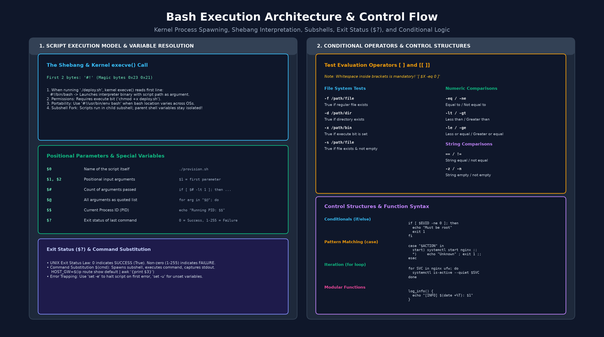
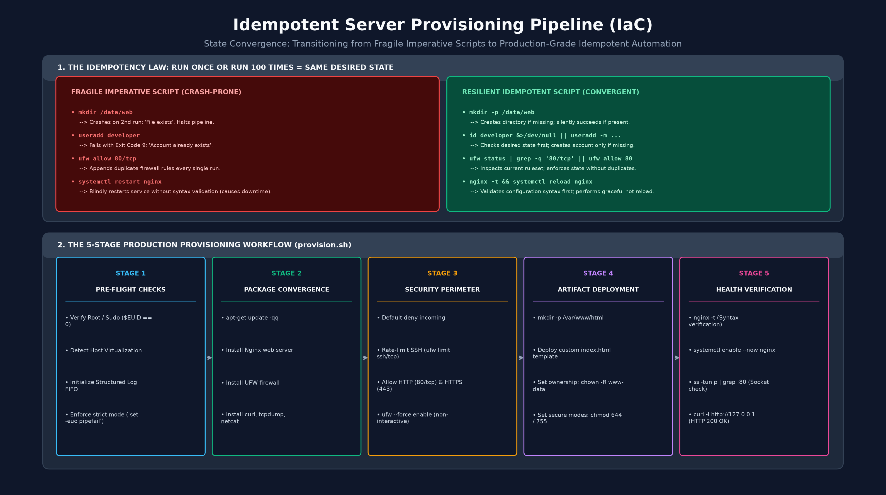

# Модуль 6: Автоматизация на Bash и скрипты инфраструктуры — Раздаточный материал для студента

Комплексное инженерное руководство по разработке скриптов оболочки, стандартам безопасного исполнения, управляющим конструкциям, модульному проектированию функций и идемпотентному развертыванию инфраструктуры.

---

## 1. Необходимость автоматизации и анатомия скрипта Bash

В промышленной DevOps-инженерии ручное выполнение команд неизбежно приводит к человеческим ошибкам, дрейфу конфигураций и неповторяемым состояниям систем. Скрипты оболочки превращают операционные регламенты в воспроизводимый, версионируемый программный код.



### 1.1 Жизненный цикл скрипта и модель исполнения ядром Linux

Когда системный администратор запускает файл скрипта через команду `./deploy.sh` в интерактивной командной строке, операционная система Linux выполняет следующую строгую последовательность шагов:

1. **Определение сигнатуры (Magic Number):** Системный вызов ядра `execve()` считывает первые байты целевого файла. Если первые два байта соответствуют сигнатуре `0x23 0x21` (символы ASCII `#!`, называемые шебангом), ядро прекращает интерпретировать файл как бинарный исполняемый файл ELF.
2. **Вызов интерпретатора:** Ядро считывает путь, указанный сразу после шебанга (обычно `/bin/bash`), и запускает этот бинарный файл, передавая путь к скрипту в качестве первого аргумента:
   ```text
   Системный вызов ядра: execve("/bin/bash", ["/bin/bash", "./deploy.sh"], [environment])
   ```
3. **Бит права на исполнение:** Дискреционный контроль доступа Linux (DAC) блокирует запуск любого файла, у которого отсутствует бит исполнения (`x`). Скрипту автоматизации необходимо явно выдать права на запуск (`chmod +x script.sh`) перед прямым вызовом. Без флага `+x` скрипт можно запустить только передав его имя интерпретатору вручную (`bash script.sh`).
4. **Изоляция подоболочки (Subshell) против Sourcing:** Запуск файла `./script.sh` создает новый дочерний процесс подоболочки через системный вызов `fork()`. Любые переменные, объявленные, измененные или удаленные внутри подоболочки, существуют исключительно в памяти этого дочернего процесса и исчезают при его завершении. Напротив, выполнение скрипта в текущем окружении (`source script.sh` или `. script.sh`) исполняет команды в контексте активной сессии терминала, сохраняя изменения переменных.

Следующие команды демонстрируют установку бита исполнения на файл скрипта и проверку назначенных прав доступа с помощью стандартных утилит Linux:

```bash
chmod +x deploy.sh
ls -l deploy.sh
```

### 1.2 Стандарты переносимости шебанга

В современных дистрибутивах Ubuntu и Debian оболочка Bash расположена по пути `/bin/bash` (который обычно является символической ссылкой на `/usr/bin/bash`). В гетерогенных окружениях, включающих различные дистрибутивы Linux, FreeBSD или macOS, абсолютный путь к интерпретатору может отличаться.

Следующие строки шебанга иллюстрируют как стандартный прямой вызов, так и переносимый вариант через утилиту `env`:

```bash
#!/bin/bash
```

Альтернативная переносимая запись запрашивает системную переменную окружения `PATH` во время запуска для динамического обнаружения исполняемого файла Bash:

```bash
#!/usr/bin/env bash
```

---

## 2. Переменные, параметры и специальные токены

Оболочка Bash работает преимущественно с нетипизированными строками. Понимание правил присваивания переменных, механизмов экранирования кавычками, подстановки параметров и специальных токенов необходимо для предотвращения сбоев во время выполнения и уязвимостей безопасности.

### 2.1 Объявление переменных и правила использования кавычек

В Bash синтаксис присваивания значений переменным категорически запрещает использование пробелов вокруг оператора присваивания (`=`). Наличие пробелов приводит к тому, что интерпретатор ошибочно принимает имя переменной за команду, а присваиваемое значение — за ее аргумент:

```bash
# Корректно: пробелы вокруг знака присваивания отсутствуют
APP_NAME="nginx"
PORT=80

# Некорректно: пробелы вызывают ошибку поиска команды с именем переменной
# APP_NAME = "nginx"   # Ошибка: команда 'APP_NAME' не найдена
# PORT = 80            # Ошибка: команда 'PORT' не найдена
```

Тип кавычек определяет, как оболочка интерпретирует специальные символы и выполняет подстановку:
- **Одинарные кавычки (`'...'`):** Сохраняют буквальное значение всех заключенных внутри символов. Подстановка переменных, вызов команд и экранирование спецсимволов полностью отключаются.
- **Двойные кавычки (`"..."`):** Разрешают подстановку значений переменных (`$VAR`), подстановку вывода команд (`$(cmd)`) и арифметические вычисления, предотвращая при этом разделение слов по пробелам (word splitting) и подстановку путей по маскам (globbing).
- **Переменные без кавычек:** Заставляют оболочку разбивать значение на отдельные слова по пробельным символам и раскрывать файловые маски, что часто приводит к повреждению путей к файлам, содержащим пробелы.

Следующие примеры демонстрируют различия между одинарными и двойными кавычками при раскрытии значений переменных в скриптах:

```bash
SYSTEM_USER="deployer"

# Одинарные кавычки подавляют раскрытие переменной и выводят текст буквально
echo 'The target user is $SYSTEM_USER'

# Двойные кавычки раскрывают переменную, сохраняя строковые границы аргумента
echo "The target user is $SYSTEM_USER"
```

### 2.2 Подстановка команд и арифметические вычисления

Подстановка команд выполняет внешнюю утилиту или конвейер в подоболочке и подставляет полученный стандартный вывод в переменную. Арифметическое раскрытие вычисляет базовые целочисленные операции без вызова внешних утилит, таких как `bc` или `expr`.

Следующие команды демонстрируют сохранение динамических системных данных в переменные и выполнение целочисленных вычислений:

```bash
# Сохранение IP-адреса шлюза по умолчанию в переменную
GATEWAY_IP=$(ip route show default | awk '{print $3}')

# Сохранение временной метки в формате ISO-8601 (строка формата пишется сразу после плюса без пробела)
TIMESTAMP=$(date +"%Y-%m-%d_%H-%M-%S")

# Целочисленные вычисления внутри конструкции $(( ... ))
TOTAL_RETRIES=3
REMAINING_RETRIES=$((TOTAL_RETRIES - 1))
```

### 2.3 Специальные переменные и позиционные параметры

При запуске скрипта Bash автоматически инициализирует системные переменные, содержащие контекст исполнения:

| Параметр | Область | Описание | Применение в продакшене |
| :--- | :--- | :--- | :--- |
| **`$0`** | Исполнение | Имя или путь к запущенному файлу скрипта. | `echo "Использование: $0 <service_name>"` |
| **`$1`, `$2`...** | Ввод | Позиционные аргументы командной строки, переданные скрипту. | `TARGET_HOST="$1"` |
| **`$#`** | Ввод | Общее количество позиционных аргументов, переданных скрипту. | `if [ "$#" -ne 2 ]; then ...` |
| **`$@`** | Ввод | Все позиционные аргументы как массив отдельных строк в кавычках (`"$1" "$2"`). | `for item in "$@"; do ...` |
| **`$*`** | Ввод | Все позиционные аргументы, объединенные в единую строку (`"$1 $2"`). | Логирование всех переданных аргументов в файл |
| **`$$`** | Время работы | Идентификатор процесса (PID) текущего экземпляра оболочки. | Запись PID в lock-файлы для контроля процессов |
| **`$?`** | Статус | Код возврата последней завершенной команды переднего плана. | Проверка успешности или сбоя предыдущего действия |
| **`$EUID`** | Идентификация | Эффективный идентификатор пользователя текущего контекста (0 для root). | `if [ "$EUID" -ne 0 ]; then ...` (Проверка root) |

Следующий фрагмент скрипта проверяет наличие обязательных позиционных аргументов перед выполнением основной логики:

```bash
if [ "$#" -lt 1 ]; then
    echo "Использование: $0 <target_username>"
    exit 1
fi

TARGET_USER="$1"
echo "Инициализация рабочего окружения для пользователя: $TARGET_USER"
```

### 2.4 Закон кодов возврата UNIX

Каждая утилита, конвейер и скрипт завершает выполнение с целочисленным кодом возврата в диапазоне от `0` до `255`:
- **`0` = Успех (True):** Команда завершилась без ошибок.
- **`1 - 255` = Сбой (False):** Произошла ошибка (например, `1` — общая ошибка, `2` — неверное использование встроенных команд, `126` — файл не может быть исполнен, `127` — команда не найдена).

Следующие команды выполняют диагностическую проверку статуса сервиса и анализируют полученный код возврата через специальный параметр `$?`:

```bash
systemctl is-active --quiet nginx
EXIT_STATUS=$?
echo "Запрос статуса Nginx вернул код завершения: $EXIT_STATUS"
```

---

## 3. Условные конструкции и операторы сравнения

Управление потоком исполнения в Bash основано на оценке кодов возврата команд. Утилита `test` (вызываемая через одинарные скобки `[ ]`) или встроенная конструкция Bash с двойными скобками `[[ ]]` вычисляют файловые, строковые и целочисленные выражения.

### 3.1 Справочник операторов проверки условий

Наличие пробелов внутри скобок проверки синтаксически обязательно. Запись `["$X" -eq 0]` приведет к ошибке выполнения, так как оболочка попытается найти исполняемый файл с именем `["$X"`.

Следующие условные операторы проверяют метаданные файловой системы перед выполнением изменений:

```bash
# -f: Истина, если путь существует и указывает на регулярный файл
[ -f "/etc/nginx/nginx.conf" ]

# -d: Истина, если путь существует и указывает на каталог
[ -d "/var/www/html" ]

# -e: Истина, если путь существует независимо от типа файла
[ -e "/var/run/web.pid" ]

# -x: Истина, если файл существует и имеет права на исполнение
[ -x "/usr/sbin/nginx" ]

# -s: Истина, если файл существует и его размер строго больше нуля байт
[ -s "/var/log/nginx/error.log" ]
```

Операторы числового сравнения работают строго с целыми числами и записываются буквенными сокращениями, а не математическими символами:

```bash
# Проверка равенства и неравенства чисел
[ "$EUID" -eq 0 ]
[ "$ACTIVE_CONNECTIONS" -ne 0 ]

# Числовые сравнения больше / меньше
[ "$DISK_USAGE_PERCENT" -gt 90 ]
[ "$RETRY_COUNT" -lt 5 ]
[ "$PROCESS_COUNT" -ge 1 ]
[ "$LOAD_AVERAGE" -le 10 ]
```

Операторы строкового сравнения оценивают лексикографическое соответствие и длину строк:

```bash
# Строковое равенство и неравенство
[ "$ENVIRONMENT" = "production" ]
[ "$SERVICE_STATUS" != "active" ]

# Проверка длины строки
[ -z "$CONFIG_FILE" ]   # Истина, если строка пустая (длина 0)
[ -n "$CONFIG_FILE" ]   # Истина, если строка не пустая (длина > 0)
```

### 3.2 Одинарные скобки `[ ]` против двойных скобок `[[ ]]`

При написании современных скриптов для Bash предпочтение всегда отдается двойным скобкам `[[ ]]`:

- **Архитектурное отличие:** Одинарные скобки `[` — это отдельная команда (встроенный псевдоним для `/usr/bin/test`), которая принимает аргументы *после* того, как стандартный парсер оболочки уже выполнил разделение слов и подстановку масок. Конструкция `[[ ]]` является ключевым словом самого Bash и парсится оболочкой напрямую как изолированное условное выражение.
- **Защита от разделения слов (Word Splitting):** В `[ ]` переменная без кавычек, содержащая пробелы или оказавшаяся пустой, распадается на несколько аргументов или исчезает, вызывая синтаксическую ошибку (`[: too many arguments`). Внутри `[[ ]]` переменные безопасно вычисляются как единый строковый литерал даже без внешних кавычек.
- **Стандартные логические операторы:** Конструкция `[[ ]]` поддерживает операторы `&&` и `||` непосредственно внутри условий. Одинарные скобки используют устаревшие флаги `-a` и `-o`, признанные стандартом POSIX нерекомендуемыми к использованию.
- **Поддержка масок и регулярных выражений:** Внутри `[[ ]]` доступно сопоставление по маскам (`== *.tar.gz`) и проверка регулярных выражений через оператор `=~`.
- **Лексикографические операторы строк:** Операторы `<` и `>` внутри `[[ ]]` выполняют сравнение строк, тогда как в `[ ]` они воспринимаются как перенаправление потоков ввода-вывода, если не экранированы (`\<`, `\>`).

| Характеристика | Одинарные скобки `[ ]` (Стандарт POSIX) | Двойные скобки `[[ ]]` (Современный Bash) |
| :--- | :--- | :--- |
| **Тип конструкции** | Встроенная команда / бинарник `/usr/bin/test` | Ключевое слово оболочки |
| **Разделение слов** | Да (переменные без кавычек вызывают синтаксические ошибки) | Нет (переменные парсятся безопасно) |
| **Логические операторы** | `-a` (И), `-o` (ИЛИ) [Устарели] | `&&` (И), `\|\|` (ИЛИ) [Стандартные] |
| **Сопоставление с шаблоном**| Нет (только строгое равенство строк) | Поддержка масок (`*`, `?`) и регулярных выражений (`=~`) |
| **Операторы строк `<` и `>`**| Требуют обязательного экранирования (`\<`, `\>`) | Работают напрямую без экранирования |

Следующий пример демонстрирует безопасность обработки пробелов и составные условия в двойных скобках:

```bash
FILE_NAME="system audit log.txt"

# Одинарные скобки вызовут сбой, разбив переменную на четыре отдельных токена:
# [ $FILE_NAME = "system audit log.txt" ]  # Ошибка: [: too many arguments

# Двойные скобки безопасно обрабатывают переменную как единую строку:
if [[ $FILE_NAME == "system audit log.txt" ]]; then
    echo "Имя файла успешно подтверждено без ошибок разбиения слов."
fi
```

---

## 4. Управляющие конструкции и модульность

### 4.1 Ветвление (`if / elif / else`)

Конструкции ветвления оценивают условия и направляют ход выполнения скрипта по соответствующим логическим веткам.

Следующая конструкция проверяет права администратора и валидирует системные зависимости перед началом работы:

```bash
if [[ "$EUID" -ne 0 ]]; then
    echo "Ошибка: Требуются права администратора. Запустите скрипт через sudo." >&2
    exit 1
elif [[ ! -f "/etc/nginx/nginx.conf" ]]; then
    echo "Ошибка: Конфигурационный файл Nginx не найден." >&2
    exit 2
else
    echo "Предварительные проверки системы успешно пройдены."
fi
```

### 4.2 Сопоставление с шаблонами (`case`)

При сравнении одной переменной с фиксированным перечнем возможных значений конструкция `case` заменяет громоздкие цепочки `if/elif` и делает код более читаемым.

Следующий фрагмент скрипта управляет жизненным циклом веб-сервера на основе переданного аргумента командной строки:

```bash
# Безопасное значение по умолчанию: пустая строка при отсутствии $1 предотвращает сбой set -u
ACTION="${1:-}"

# Маршрутизация выполнения на основе значения параметра
case "$ACTION" in
    start)
        systemctl start nginx
        ;;
    stop)
        systemctl stop nginx
        ;;
    restart|reload)
        nginx -t && systemctl reload nginx
        ;;
    status)
        systemctl status nginx
        ;;
    *)
        # Шаблон по умолчанию: срабатывает при некорректных аргументах
        echo "Использование: $0 {start|stop|restart|status}" >&2
        exit 1
        ;;
esac
```

### 4.3 Итерация (циклы `for` и `while`)

Цикл `for` перебирает элементы в списке строк, массиве или файлы, подпадающие под файловые маски оболочки.

Следующий цикл опрашивает список системных демонов и выводит их текущий операционный статус:

```bash
for SERVICE_NAME in nginx ssh ufw; do
    if systemctl is-active --quiet "$SERVICE_NAME"; then
        echo "Служба $SERVICE_NAME активна и работает."
    else
        echo "Служба $SERVICE_NAME остановлена или недоступна."
    fi
done
```

## 5. Стандарты надежности в продакшене и защитное программирование

Автоматизация продакшен-систем требует строгого соблюдения защитного программирования: скрипт обязан немедленно прерывать выполнение при возникновении непредвиденных ошибок, а не продолжать работу в поврежденном окружении.

### 5.1 Строгие флаги интерпретатора (`set -euo pipefail`)

В начале каждого промышленного скрипта на Bash сразу под шебангом объявляются строгие защитные флаги:

```bash
set -euo pipefail
```

Техническое назначение каждого флага подробно описано ниже:
- **`set -e` (Немедленный выход):** Заставляет интерпретатор немедленно завершить работу скрипта, если любая команда возвращает ненулевой код возврата. Исключение составляют проверки внутри условий `if`, циклов `while` или выражений с оператором `||`.
- **`set -u` (Ошибка при необъявленных переменных):** Трактует обращение к неинициализированным переменным как критическую ошибку и прерывает скрипт. Это предотвращает катастрофические сценарии вида `rm -rf /${CACHE_DIR}/*`, которые при пустой переменной `CACHE_DIR` превращаются в `rm -rf /*`. Флаг также перехватывает отсутствие позиционных аргументов (например, обращение к `$1`, если пользователь ничего не передал).
- **`set -o pipefail` (Контроль сбоев в конвейерах):** По умолчанию конвейер возвращает код завершения последней команды, скрывая сбои промежуточных утилит. Флаг `pipefail` гарантирует, что если хотя бы одна команда в конвейере завершилась с ошибкой, весь конвейер вернет этот ненулевой код завершения.

Следующий пример демонстрирует правильное объявление защитных инструкций в заголовке скрипта автоматизации:

```bash
#!/bin/bash
# Защитные флаги интерпретатора:
# -e: Немедленный выход при возврате ненулевого кода ошибки любой командой
# -u: Завершение работы при обращении к необъявленным переменным и позиционным параметрам ($1, $2)
# -o pipefail: Предотвращение сокрытия ошибок в конвейерах завершающими командами
set -euo pipefail
```

---

## 6. Принцип идемпотентности и сходимость состояния

Фундаментальный принцип концепции «Инфраструктура как код» (IaC) — **Идемпотентность**. Этот математический принцип ($f(f(x)) = f(x)$) означает, что скрипт автоматизации является идемпотентным, если его однократный запуск приводит систему в целевое состояние, а повторное выполнение 100 раз подряд сохраняет то же самое целевое состояние без ошибок, дублирования данных или сбоев.



### 6.1 Императивный и декларативный подходы

В таблице ниже приведены различия между нестабильными императивными командами и устойчивыми идемпотентными паттернами:

| Операционная задача | Нестабильный императивный паттерн | Устойчивый идемпотентный паттерн |
| :--- | :--- | :--- |
| **Создание каталога** | `mkdir /data/web`<br>*(Сбой при повторе: каталог уже существует)* | `mkdir -p /data/web`<br>*(Создает каталог при отсутствии; тихо выходит 0, если он есть)* |
| **Создание пользователя** | `useradd developer`<br>*(Сбой при повторе: аккаунт уже создан)* | `id "developer" &>/dev/null \|\| useradd -m -s /bin/bash "developer"`<br>*(Сначала проверяет наличие; создает только при отсутствии)* |
| **Установка пакетов** | `apt-get install nginx`<br>*(Интерактивные запросы и зависания)* | `apt-get update -qq && apt-get install -y -qq nginx`<br>*(Автоматический режим с проверкой текущего статуса)* |
| **Настройка фаервола** | `ufw allow 80/tcp`<br>*(Дублирует правила в цепочке при каждом вызове)* | `ufw status \| grep -q '80/tcp' \|\| ufw allow 80/tcp`<br>*(Проверяет наличие правила перед добавлением)* |
| **Перезапуск демона** | `systemctl restart nginx`<br>*(Вызывает простой при ошибках в конфигурации)* | `nginx -t && systemctl reload nginx`<br>*(Валидирует синтаксис; перезагружает без разрыва соединений)* |
| **Конфигурация файлов** | `echo "setting=val" >> /etc/app.conf`<br>*(Дублирует строки при каждом запуске)* | `grep -qxF 'setting=val' /etc/app.conf \|\| echo 'setting=val' >> /etc/app.conf`<br>*(Добавляет строку только при ее отсутствии)* |

Следующий фрагмент скрипта демонстрирует идемпотентное создание рабочего каталога и инициализацию файла:

```bash
WEB_ROOT="/var/www/html"

mkdir -p "$WEB_ROOT"
if [ ! -f "$WEB_ROOT/index.html" ]; then
    echo "<h1>Стенд успешно развернут</h1>" > "$WEB_ROOT/index.html"
fi
```

---